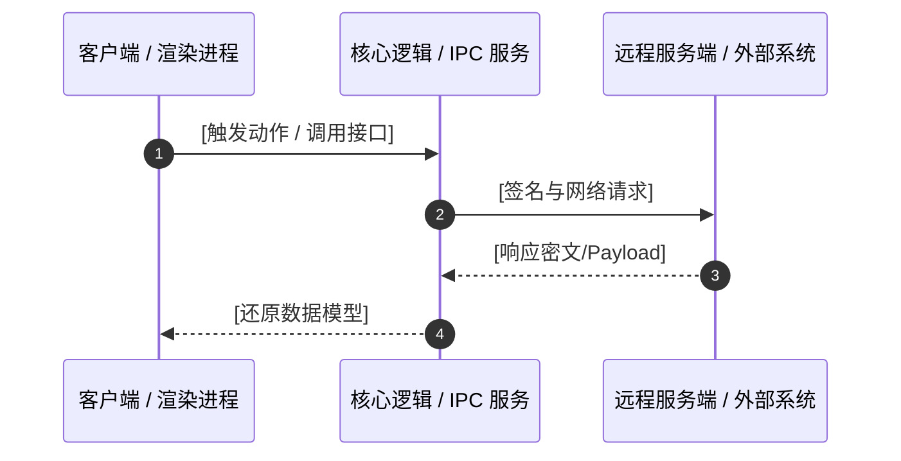

# 逆向分析与契约还原报告 (REA Evidence-Based Report)

## 1. 资产概览 (Asset Overview)
- **分析标的**：`[文件名或服务路径]`
- **目标类型**：`[Electron ASAR | Web/API | .NET Assembly | Native Binary]`
- **文件指纹**：`SHA-256: [哈希值]`
- **分析目标**：`[用户指定的具体逆向/还原目标]`

---

## 2. 架构拓扑与交互时序 (Architecture & Flow)



---

## 3. TypeScript 还原契约 (Reconstructed Contracts)

```typescript
/**
 * 逆向还原的核心数据模型与接口契约
 */

export interface AnalyzedPayload {
  version: string;
  timestamp: number;
  data: Record<string, unknown>;
}

export interface ReconstructedApi {
  /**
   * 接口说明与逆向提取的入参与出参
   */
  invoke(params: AnalyzedPayload): Promise<boolean>;
}
```

---

## 4. 确凿证据清单 (Evidence List)

| 序号 | 证据类型 | 文件/模块与行号 | 关键代码/十六进制片段 | 证明的事实 |
| :--- | :--- | :--- | :--- | :--- |
| 01 | 静态引用 | `app/dist/main.js:142` | `ipcMain.handle('auth-login', ...)` | 证实登录逻辑由主进程处理 |
| 02 | 结构导出 | `bundle.js:890` | `crypto.createCipheriv('aes-128-cbc', ...)` | 证实采用 AES-128-CBC 加密 |

---

## 5. 局限性与待确认盲区 (Limitations & Unexplored Paths)
- [ ] 针对混淆变量 `_0x4f12` 的最终跳转逻辑未完全穷举；
- [ ] 动态环境特定参数（如硬件指纹收集）依赖运行时真实物理机反馈。
