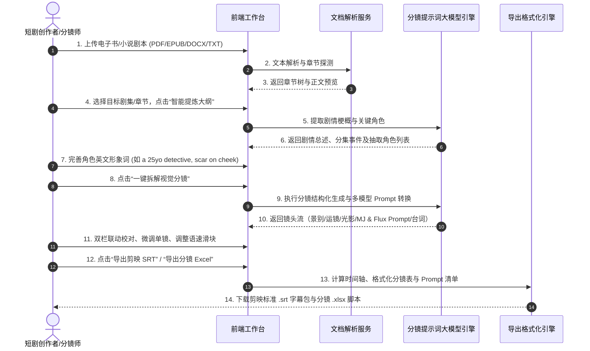
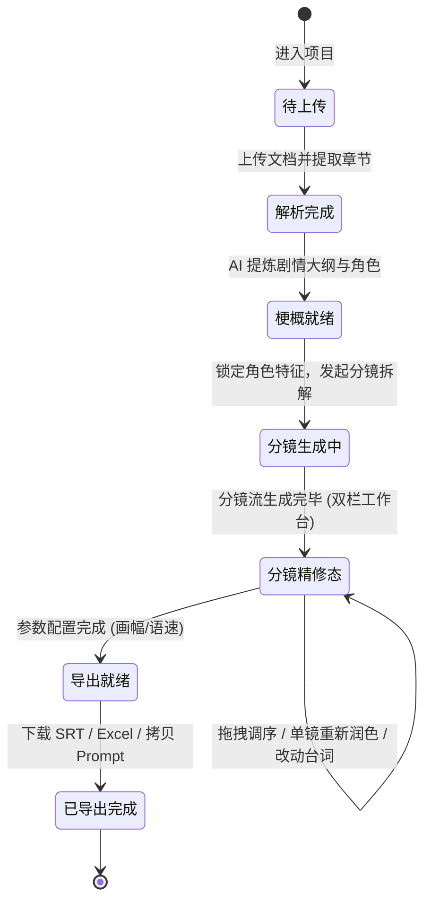

# 【产品需求文档】AI-StoryBoard-Studio 剧创智能分镜工场 (PRD)

| 文档版本 | 文档状态 | 编写人 | 创建日期 | 评审日期 |
| :--- | :--- | :--- | :--- | :--- |
| V1.0.0 (MVP) | Approved (评审通过) | PM (Superpower 问答对齐) | 2026-11-03 | 2026-11-03 |

---

## 1. 需求背景与业务价值

### 1.1 业务背景与问题痛点
当前短剧、漫剧（Motion Comic）、AI 慢剧（Slow Cinema/氛围短片）行业处于爆发期，尤其在抖音、快手、ReelShort、ShortMax 等海内外短视频平台日均产出需求极大。制作团队的核心痛点集中在从“网文小说”到“可执行分镜”与“生成物料”的断层链路：
1. **长篇网文转剧本耗时巨大**：动辄百万字的网络小说，传统编剧人工通读、拆章、提炼 1~3 分钟短剧大纲需花费数天。
2. **分镜缺乏影视工业标准化语言**：非专业编剧/新人分镜师缺乏景别（Close-up, Wide shot）、机位运镜（Pan, Tilt, Dolly）、光影氛围（Volumetric lighting, Golden hour）的规范描述，导致下游 AI 生图质量参差不齐。
3. **生图模型 Prompt 门槛高且碎片化**：不同文生图模型语法差异极大——Midjourney 依赖特定参数（`--ar 9:16 --v 6.1 --style raw`），Flux.1 依赖高密度的自然语言材质与光线叙述，即梦（Dreamina）依赖精炼双语，创作者反复手工翻译拼凑极其低效。
4. **角色一致性难以维护**：不同镜头之间人物长相、发型、服装容易漂移走形。
5. **剪辑与字幕断层**：台词需要人工从小说逐句剥离，手动打轴输入剪映，耗费至少 30% 以上的后期剪辑时间。

### 1.2 业务目标与价值衡量 (Success Metrics)
- **核心目标**：构建专为 AI 短剧/慢剧制作团队打造的端到端提效工作台，打通“小说文档上传 -> 剧情梗概提炼 -> 角色一致性管理 -> 影视级分镜智能拆解 -> 多模型英文 Prompt 适配 -> 剪映标准 SRT 与分镜表一键导出”闭环。
- **衡量指标 (KPI / North Star Metric)**：
  - **单集分镜生产周期**：单集（1~2 分钟短剧）从小说原文到标准分镜与 SRT 文件的交付耗时从传统的 **4~8 小时缩短至 10 分钟内（提效 90%+）**。
  - **Prompt 生图可用率**：AI 生成的英文标准分镜 Prompt 导入 Midjourney / Flux 后，第一轮有效成片率提升至 **80% 以上**。
  - **剪映字幕对齐零修改率**：导出的 `.srt` 字幕导入剪映后，语速与断句契合度达 **95%+**，支持直接套用剪映文本朗读。

---

## 2. 用户角色与画像

| 角色名称 | 核心职责/定位 | 使用频次 | 核心诉求 | 关键权限 |
| :--- | :--- | :--- | :--- | :--- |
| **短剧编剧/策划** | 小说筛选、剧情大纲把控、集数规划 | 高频 (每日) | 快速解析整本网文，快速生成分集高潮点与剧本梗概 | 剧本导入、章节切分、剧情润色 |
| **AI 分镜师/视觉总监** | 分镜脚本设计、生图 Prompt 调试与构图 | 高频 (核心操作者) | 专业镜头语言（景别/运镜/光影）、MJ/Flux 英文 Prompt 一键复制、角色外观一致性锁定 | 分镜增删改、Prompt 编辑、角色库配置 |
| **后期剪辑/制作人** | 画面剪辑、配音配乐、字幕对齐 | 高频 (每日) | 直接导出符合剪映规范的 `.srt` 字幕与分镜表格 `.xlsx`，无缝衔接后期软件 | 全量导出、格式配置 |

---

## 3. 需求范围与边界界定

### 3.1 包含范围 (In-Scope / MVP)
- [x] **多格式长篇文档解析**：支持 `.pdf`（带文本层）、`.epub`、`.docx`、`.txt` 格式解析，自动抽取章节目录树。
- [x] **剧情分级切分与梗概提炼**：支持“全书总梗概 -> 分集大纲与冲突点 -> 单集剧本拆解”的分级推进机制。
- [x] **角色资产库与一致性锚定**：自动抽取剧本主要角色，支持配置英文形象特征词与 `--cref` 参数占位符。
- [x] **影视级分镜规范拆解**：镜头号、景别、机位运镜、角色动作表情、环境光影、台词对白、音效提示全面结构化。
- [x] **多模型英文 Prompt 适配引擎**：针对同一分镜，提供 Midjourney、Flux.1、即梦（Dreamina）/通用三种格式的英文标准提示词，支持 9:16 竖屏与 16:9 横屏构图语法。
- [x] **双栏联动精修工作台**：左侧原文高亮对照、右侧分镜瀑布流卡片，支持单镜头拖拽调序、重新润色、增删改。
- [x] **智能配音基准与剪映高保真 SRT 导出**：支持 3.5~6 字/秒语速调节、0.3~0.5s 停顿呼吸位、手机端单行 18 汉字安全截断、角色名开关。
- [x] **工业级分镜表格与批量 Prompt 导出**：支持导出 `.xlsx`、`.csv` 及一键复制全集生图 Prompt。

### 3.2 不包含范围 (Out-of-Scope / Non-Goals)
- ❌ **暂不内置文生图在线生图 API（如直接调用 Midjourney/Flux 生成图像）**：MVP 专注于打造极致的文本分镜脚本与工业级提示词导出，避免用户因高昂的 API 生图成本和并发等待受限（V2.0 规划接入）。
- ❌ **暂不内置 TTS 语音合成引擎**：优先打通剪映内置的丰富音色库与自动文本朗读能力，通过高保真 SRT 直接在剪映内闭环。
- ❌ **暂不支持纯图片扫描版 PDF 的内置重度 OCR**：纯图片 PDF 要求用户先在外部 OCR 后上传文本，确保解析响应秒级完成。
- ❌ **暂不支持多人实时协同协同光标编辑**（延后至 V2.0 团队版）。

---

## 4. 业务架构与全局流程

### 4.1 核心业务主流程 (Sequence Diagram)

### 4.2 核心业务状态机流转 (State Diagram)

---

## 5. 功能需求详细说明 (Feature Breakdown)

### 模块一：电子书与小说剧本解析引擎

#### 功能点 F-01：多格式长篇文档上传与解析（优先级：P0）
1. **功能概述**：创作者上传原著小说或剧本文档，系统提取正文文本并建立章节目录索引。
2. **前置条件**：用户进入工作台新建项目。
3. **界面/交互说明**：
   - 拖拽或点击上传区域，支持格式展示：`.pdf`、`.epub`、`.docx`、`.txt`，单文件上限 20MB。
   - 上传后展示文档基础信息（字数统计、预估集数、章节列表）。
4. **业务处理逻辑与规则**：
   - **格式解析**：
     - `.txt`：按正则表达式（如 `第[0-9一二三四两百千万]+[章回节集]`）智能切分章节。
     - `.epub`：读取 NCX 目录索引与 XHTML 正文文本。
     - `.docx`：读取段落与大纲级别 Heading 1~3。
     - `.pdf`：通过 PDF 文本层提取器提取字符流，若连续 3 页字符数为 0，判定为扫描版并阻断拦截。
5. **异常与分支情况**：
   - 上传纯图片 PDF：弹出警示 Modal：“检测到扫描版纯图片 PDF，暂不支持直接解析，请转换为带文本层 PDF 或 TXT 后重新上传”。
   - 乱码保护：自动探测 UTF-8 / GBK / UTF-16 编码，防止中文乱码。

---

### 模块二：剧本提炼与角色一致性资产库

#### 功能点 F-02：分级切分与剧情大纲提炼（优先级：P0）
1. **功能概述**：针对长篇网络小说，先提炼全局剧情梗概与分集事件节点，便于用户精准定位要制作的具体集数。
2. **前置条件**：文档解析成功且已选定目标章节。
3. **界面/交互说明**：
   - 左侧展示“分集目录面板”（如：第 1 集：战神归来受辱；第 2 集：亮明身份打脸）。
   - 选中某一集，中间主面板展开该集 500~1200 字的核心剧情梗概与高潮反转点。
4. **业务处理逻辑与规则**：
   - 系统内置短剧叙事节奏模板（黄金前 3 秒钩子、1 分钟冲突升级、单集结尾反转悬念卡点）。
   - 允许用户手动微调该集剧情文本后再启动分镜拆解。

#### 功能点 F-03：角色一致性资产库管理（优先级：P0）
1. **功能概述**：自动抽取小说核心角色，允许用户配置其统一的英文外貌特征词或 Midjourney 参考参数。
2. **前置条件**：剧情梗概提炼完毕。
3. **界面/交互说明**：
   - 右侧或抽屉式面板呈现“角色卡片列表”（如：顾北辰、苏清影）。
   - 每张角色卡片包含：中文名、身份定位（男主/反派）、英文 Prompt 形象特征词、参考图 URL/`--cref` 占位符。
4. **业务处理逻辑与规则**：
   - AI 自动基于小说描述推荐英文特征词（例如：`a 28-year-old cold and domineering Asian male CEO with sharp jawline, short neat black hair, wearing bespoke charcoal tailored suit`）。
   - 用户编辑保存后，在后续生成每个分镜的英文 Prompt 时，若该镜头出现该角色，系统自动注入其一致性外貌特征词。

---

### 模块三：影视级分镜脚本智能拆解引擎

#### 功能点 F-04：标准化视听语言拆解（优先级：P0）
1. **功能概述**：将单集剧情智能拆解为 15~35 个影视级分镜镜头。
2. **前置条件**：选定剧集并确认角色库。
3. **界面/交互说明**：
   - 卡片式瀑布流展示，每个分镜卡片具备清晰的视听语言分区。
4. **业务处理逻辑与规则（核心数据模型）**：
   每个分镜镜头必须输出以下完整结构化字段：
   - `shot_number` (镜头号)：自增整数，如 `Shot 01`。
   - `duration_sec` (预估时长)：基于镜头台词与动作预估，默认 2.0s ~ 5.0s。
   - `shot_size` (景别)：标准下拉/标记，如【大特写 Extreme Close-up】、【特写 Close-up】、【中景 Medium Shot】、【全景 Full Shot】、【远景 Wide Shot】。
   - `camera_movement` (机位运镜)：如【平拍定镜 Static Eye-level】、【低角度仰拍推镜 Low-angle Slow Dolly In】、【俯拍全景 Bird's-eye Tilt Down】、【跟随摇镜 Pan Following】。
   - `character_action_expression` (角色与表情动作)：详细人物动作、眼神与微表情（如：咬紧牙关、嘴角轻蔑冷笑、双拳颤抖）。
   - `environment_lighting` (环境场景与光影)：环境质感与色调氛围（如：昏暗豪门雨夜、巴洛克式吊灯顶光、冷色调蓝光剪影）。
   - `dialogue` (台词对白)：说话角色名 + 对白内容（如 `顾北辰：“三年之期已到，尔等跪下！”`）。
   - `sound_effect_bgm` (音效与配乐)：环境音效与氛围情绪（如：骤雨雷声炸响、低沉大提琴悬疑渐起）。

---

### 模块四：多生图模型英文标准 Prompt 引擎

#### 功能点 F-05：Midjourney / Flux / 即梦 提示词适配（优先级：P0）
1. **功能概述**：在分镜卡片中，将中文视听语言与角色资产无缝转换为匹配不同生成模型的标准英文提示词。
2. **前置条件**：分镜拆解完成。
3. **界面/交互说明**：
   - 单镜卡片提供 **[Midjourney] [Flux.1] [即梦/通用]** 三个 Tab 标签页。
   - 右上角配备“一键复制当前 Prompt”和“语法说明 Tooltip”。
4. **业务处理逻辑与规则**：
   - **画幅比例注入**：
     - 若项目配置为 `9:16 竖屏`：Midjourney 自动注入 `--ar 9:16`；Flux 注入 `vertical 9:16 framing, mobile cinematic composition`。
     - 若项目配置为 `16:9 横屏`：Midjourney 自动注入 `--ar 16:9`；Flux 注入 `cinematic 16:9 widescreen composition, anamorphic flare`。
   - **模型专属 Prompt 构造规范**：
     - **Midjourney 格式**：
       `[Subject & Action with Character Preset], [Camera Shot Size & Angle], [Lighting & Atmosphere], [Scene Background], 8k, cinematic lighting, masterpiece, photorealistic, --ar 9:16 --v 6.1 --style raw [Optional --cref URL]`
     - **Flux.1 格式**：
       注重全自然语言长文描述，精准刻画材质肌理与光影色彩流动：
       `A high quality cinematic vertical 9:16 shot. [Character detailed features, expression and clothing]. The camera is [shot angle and movement], capturing [scene details]. The lighting is [lighting setup], casting [shadow details]. Rich details, highly defined textures, 35mm film still.`
     - **即梦 (Dreamina) / 通用格式**：
       精炼关键词或双语混合描述，契合国产模型语义习惯。

---

### 模块五：双栏联动精修工作台

#### 功能点 F-06：双栏联动与交互精修（优先级：P0）
1. **功能概述**：为分镜师提供高沉浸式的交互校验平台，打通原文与分镜映射关系。
2. **前置条件**：分镜生成完成。
3. **界面/交互说明**：
   - **左栏**：小说剧本原文。鼠标悬浮或点击右侧分镜卡片时，左侧原文对应的句子自动高亮变色（黄色/蓝色底色），并平滑滚动到可视区。
   - **右栏**：可视化分镜瀑布流卡片。
   - **卡片快捷操作**：
     - 拖拽卡片调整镜头先后顺序（镜头序号自动重编）。
     - 支持“+ 插入空白镜头”、“删除镜头”、“单镜一键 AI 重新润色”。
     - 文本框就地双击编辑（In-place Edit）。

---

### 模块六：剪映标准 SRT 与物料导出引擎

#### 功能点 F-07：智能配音基准与 SRT 时间轴计算（优先级：P0）
1. **功能概述**：将无时间戳的小说对白文本，自动计算出高度契合剪映导入标准的 `.srt` 字幕文件。
2. **前置条件**：分镜中已提取出有效台词对白。
3. **界面/交互说明**：
   - 顶部工具栏提供“配音语速调节滑块”：默认 **4.5 字/秒**（范围 3.5 ~ 6.0 字/秒，步长 0.1）。
   - 旁白角色名导出开关：“保留角色前缀（如 `[顾北辰]:`）” vs “纯台词内容”。
4. **业务处理逻辑与规则（核心时序算法）**：
   - **单句时长计算**：`Duration = (汉字字符数 / 语速) + 0.3s (尾音自然衰减)`，最小持续时间不低于 1.0 秒。
   - **镜头与台词间隙**：句与句之间自动插入 `0.35s` 停顿呼吸间距。
   - **安全换行与截断防溢出**：
     - 若单句汉字数量超过 **18 个汉字**（英文超过 36 个字符），且包含逗号或停顿词，算法自动拆分为前后两条连续字幕，防止手机竖屏炸屏或折行遮挡。
   - **标准格式规范**：输出 UTF-8 编码、三位毫秒标准（`HH:MM:SS,mmm`），严格符合剪映桌面版与移动端直接导入解析标准。

#### 功能点 F-08：工业级分镜表格与全集 Prompt 导出（优先级：P0）
1. **功能概述**：一键导出影视级 Excel/CSV 分镜脚本及生图 Prompt 集合。
2. **前置条件**：分镜完成并校对。
3. **界面/交互说明**：
   - 点击“导出”下拉菜单：
     - 📄 **导出剪映字幕 (.srt)**
     - 📊 **导出分镜脚本表 (.xlsx / .csv)**（包含镜头号、景别、运镜、画面描述、光影、台词、MJ 词、Flux 词）
     - 📋 **一键复制全集 Midjourney Prompt**（每行一镜，直接粘贴进 Discord 批处理插件或生图工具）
     - 📋 **一键复制全集 Flux Prompt**

---

## 6. 非功能性需求 (NFR)

1. **大模型推理与流式响应性能**：
   - 电子书分镜拆解必须采用**流式传输 (Server-Sent Events / WebSocket)**，分镜卡片随 AI 推理逐个逐镜实时打字呈现，首镜响应时间 (TTFT) < 2.5 秒。
   - 单集完整分镜拆解（20~30 镜）端到端推理完成时间 < 30 秒。
2. **长文本 Token 经济性与防溢出保护**：
   - 解析网络小说长章节时，采用分块滑动窗口（Sliding Window）结合 Map-Reduce 剧情提取机制，单次请求输入 Prompt 严格控制在模型 Context Window 安全水位（< 32k Tokens），避免 OOM 或截断失忆。
3. **前端高可用与离线缓存**：
   - 基于 LocalStorage / IndexedDB 实时自动暂存用户的编辑状态，浏览器意外关闭、网络闪断或刷新后草稿 100% 自动恢复。
4. **浏览器兼容性**：
   - 支持 Chrome 90+、Edge、Safari 最新两代主流现代浏览器，适配 1920x1080、2560x1440 等主流剪辑桌面分辨率。

---

## 7. 数据埋点与监控看板

| 埋点事件名称 | 事件标识 (Event ID) | 触发时机 | 关键参数 | 业务分析目的 |
| :--- | :--- | :--- | :--- | :--- |
| 上传文档完成 | `doc_upload_success` | 文档解析完成返回章节树时 | `file_type, file_size, chapter_count` | 统计主流输入格式与文档体量 |
| 启动分镜拆解 | `shot_generate_start` | 用户点击“一键拆解分镜” | `project_id, episode_id, char_count` | 衡量分镜功能使用频次与热度 |
| 分镜生成成功 | `shot_generate_success` | 后端全量生成分镜卡片完成 | `shot_count, duration_cost_ms` | 监控大模型端到端响应耗时与稳定性 |
| 复制模型Prompt | `prompt_copy_click` | 用户点击 MJ/Flux/即梦 复制按钮 | `model_type, shot_index` | 分析不同生图模型的受欢迎程度 |
| 导出剪映SRT | `export_srt_click` | 用户下载剪映标准 .srt 字幕文件 | `speed_rate, subtitle_line_count` | 衡量后期剪映工作流导出转化率 |
| 导出分镜Excel | `export_excel_click` | 用户下载分镜 .xlsx 表格 | `shot_count` | 衡量工业级表格交付使用率 |

---

## 8. 实施计划与里程碑 (Milestones)

| 阶段 | 周期 | 核心交付物 | 责任人 | 验收准则 |
| :--- | :--- | :--- | :--- | :--- |
| **Phase 1: 需求对齐与 TRD 设计** | Day 1~2 | PRD 评审归档、TRD 架构设计、接口契约与数据模型定义 | PM / 架构师 | PRD 签字、TRD 评审无阻碍点 |
| **Phase 2: 核心引擎开发 (TDD)** | Day 3~5 | 文档解析服务、分镜拆解 Prompt 管道、剪映 SRT 生成器单测通过 | 后端研发 | 核心算法单元测试覆盖率 > 85% |
| **Phase 3: 现代化前端工作台构建** | Day 6~8 | Vue 3 / React + TS 双栏联动视图、角色资产库抽屉、分镜卡片流 | 前端研发 | 交互流畅无卡顿、响应式适配良好 |
| **Phase 4: 全链路联调与真机剪映测试** | Day 9~10 | 真实网文多集联跑，导出 SRT 导入剪映真机验证对齐与折行 | QA / PM | 剪映直接导入 100% 成功、无乱码与折行 |
| **Phase 5: MVP 发布与反馈迭代** | Day 11 | 内测上线、埋点监控看板就绪、用户操作手册 | 全体团队 | 首批短剧制作人试用，NPS > 60 |

---

## 9. 风险识别与应对方案 (Contingency Plans)

| 潜在风险项 | 严重级别 | 应对与缓解策略 |
| :--- | :--- | :--- |
| **剪映版本更新对 SRT 格式兼容突变** | 中 | 严格遵循标准 SRT 基础规范（序号 + 时码 + 纯文本），避免任何专有私有 Tag；建立自动化测试套件定期验证剪映桌面版与移动端导入兼容性。 |
| **文生图模型（如 MJ v6 到 v7）参数语法更迭** | 中 | Prompt 生成器采用配置化模板引擎（Template Strategy Pattern），模型参数词典与前缀后缀独立维护，一旦模型升级只需热更新配置，无需重写底层业务代码。 |
| **大篇幅小说拆解时剧情逻辑跳跃或角色幻觉** | 高 | 引入角色资产库强约束注入，在系统 Prompt 中加入严格的“原著情节锚定机制”，禁止 AI 凭空捏造无关支线；提供双栏原文对照供分镜师一键纠错。 |
