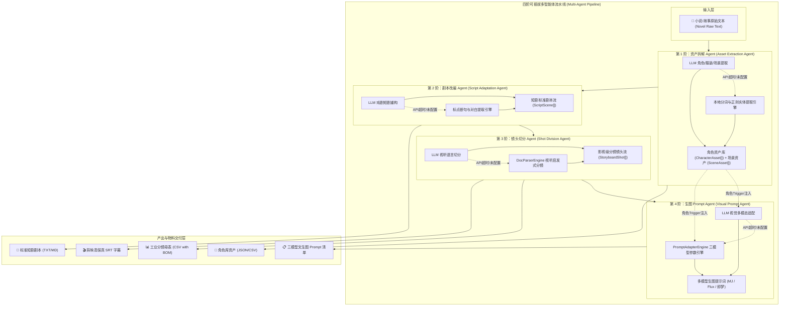

# 【产品需求文档】AI-StoryBoard-Studio 多智能体可插拔工作流分镜工场 (PRD)

| 文档版本 | 文档状态 | 编写人 | 创建日期 | 评审日期 | 架构基线 |
| :--- | :--- | :--- | :--- | :--- | :--- |
| **V2.0.0** | Approved (3轮Superpower问答全量通过) | PM (Superpower 驱动) | 2026-11-05 | 2026-11-05 | **Multi-Agent Pipeline Architecture (可插拔多智能体工作流)** |

---

## 1. 需求背景与核心价值 (Why & Who)

### 1.1 业务背景与单体化瓶颈
在 AI-StoryBoard-Studio V1.0 中，系统已成功打通了小说文本到分镜与剪映 SRT 的链路。然而在面向长篇复杂网文、强视觉风格短剧的实际工业化生产中，传统的**单体化大模型 Prompt 拆解**暴露了三大结构性瓶颈：
1. **职责过载导致幻觉与精度稀释**：要求单一 LLM 同时完成“提炼角色”、“改写对白”、“切分影视镜头”与“翻译生图提示词”，导致模型注意力分散，经常遗漏原著中对角色穿搭、发型特写的描述，或将旁观角色的台词与主角串角。
2. **缺乏中间态导演干预（无法分步质检）**：编剧在审阅改写的剧本时，分镜和 Prompt 往往已经连带生成完毕；若要修改剧本台词，传统架构必须重跑全局，导致已人工精调好的镜头彻底作废，缺乏“人机协同微调（Human-in-the-loop）”的中间态承载。
3. **黑盒硬编码导致无法定制模型组合**：小说实体提取（如 DeepSeek-Chat / 本地实体识别模型更擅长且成本低）、短剧剧本改编（要求强文学功底与戏剧卡点）、镜头语言切分与英文生图 Prompt（需要精通 Midjourney/Flux 参数体系）适合由专精的专业 Agent 承担，亟需支持各节点**模型独立解耦与可插拔替换**。

### 1.2 业务目标与价值衡量 (Success Metrics)
- **核心目标**：将分镜生产线重构为**基于 4 个专业 Agent 的可插拔流水线（Pluggable Multi-Agent Pipeline）**，实现“资产提取 ➔ 剧本改编 ➔ 镜头切分 ➔ 生图 Prompt”各环节的工业化解耦与半自动导演协同。
- **衡量指标 (KPI / North Star Metric)**：
  - **角色与场景视觉一致性率**：角色服装、发型与环境光影在多镜头间的视觉一致性达 **90% 以上**（依托独立资产 Agent 的锚定）。
  - **人机协同返工损耗降低**：支持单节点重跑与上游变更保护，修改单步剧本时下游分镜的有效保留率达 **85% 以上**。
  - **开箱即用与极端容错率**：单节点 API 故障或断网时，内置离线规则保底引擎无缝自愈，流水线 **100% 成功交付**，零崩溃率。

---

## 2. 用户角色与画像

| 角色名称 | 核心职责/定位 | 使用频次 | 核心诉求 | 关键权限 |
| :--- | :--- | :--- | :--- | :--- |
| **短剧策划/编剧** | 小说提炼、短剧戏剧卡点、台词对白设计 | 高频 | 专注于剧本 Agent 的改写质量，在剧本阶段微调对白和潜台词，不被镜头参数打扰 | 剧本导入、场次改写、角色库资产管理 |
| **AI 视觉总监/分镜师** | 镜头景别构图、机位运镜、生图 Prompt 调试 | 高频 | 专注于镜头 Agent 与 Prompt Agent，支持为 MJ / Flux 调参，一键复制高质量提示词 | 分镜流调整、Prompt 微调、生图清单导出 |
| **后期剪辑/制作人** | 声音配乐节奏、字幕时码、最终成片合成 | 高频 | 依托剪映标准高保真 SRT 字幕与工业分镜母表快速在后期软件排期 | 配音语速调节、全套物料打包导出 |

---

## 3. 需求范围与边界界定 (In-Scope vs Non-Goals)

### 3.1 包含范围 (In-Scope / V2.0 MVP)
- [x] **四阶专业 Agent 编排管线**：
  1. **拆解 Agent (Asset Extraction Agent)**：提取角色库（姓名、年龄、外貌、服装穿搭、Trigger Prompt）与核心场景特征。
  2. **剧本 Agent (Script Adaptation Agent)**：将网文小说小说叙述文本改写为标准影视短剧剧本（场次、环境、动作、带情绪对白）。
  3. **镜头 Agent (Shot Division Agent)**：将剧本按视听节奏转化为镜头流（景别、运镜、时长、对白归属）。
  4. **Prompt Agent (Visual Prompt Agent)**：将镜头构图与角色资产融合，生成 Midjourney、Flux.1、即梦三模型高保真提示词。
- [x] **顶部工作流横向流水线看板 (Workflow Stepper Pipeline)**：
  - 呈现 4 个节点的当前状态（待处理 ⚪ / 运行中 ⏳ / 已就绪 🟢 / 已跳过 ⏩）；
  - 支持 **「⚡ 一键全流水线执行」** 与各节点单独的 **「▶ 运行此 Agent」**。
- [x] **双栏聚焦工作区与节点专属视图**：
  - 左栏（32%）：小说/剧本原始输入区与段落对照流；
  - 右栏（68% 全展开）：自适应呈现当前流水线节点的专属工作台，告别三栏拥挤。
- [x] **Agent 配置工坊与可插拔管理 (Agent Hub Modal)**：
  - 支持为 4 个 Agent 分别配置独立的 LLM API（BaseUrl、ApiKey、Model、Temperature、System Prompt 模板）；
  - 支持单个 Agent 节点开关（支持直通输入，例如关闭剧本 Agent 时直接输入成品剧本）。
- [x] **全节点离线规则保底网（Graceful Degradation）**：
  - 任意 Agent 遇大模型故障、限流或格式异常时，自动无缝切换为对应的本地规则引擎，流程绝不中断。
- [x] **Prompt 视窗全面弹窗化 (Prompt Modal)**：
  - 每个分镜卡片配备专属「🎯 生图 Prompt 弹窗」入口，支持全屏大字号深黑底色实时编辑与一键复制。
- [x] **全生命周期工业物料资产包导出**：
  - 角色资产表 (.CSV/.JSON)、标准文学剧本 (.TXT)、分镜母表 (.CSV)、全集 Prompt 清单、剪映 SRT 字幕。

### 3.2 不包含范围 (Out-of-Scope / Non-Goals)
- ❌ **暂不在系统内直接调用付费商业生图 API 消耗额度（如 Midjourney API / GPU 集群）**：创作者通过 Prompt 复制在 Discord / WebUI / ComfyUI / 即梦中以低成本甚至免费算力生成，系统专注输出最高质量指令。
- ❌ **暂不引入复杂的外部图数据库与庞大分布式 DAG 编排引擎（如 Celery / Airflow）**：为保障轻量级内网开箱即用，工作流调度引擎完全在本地 TypeScript 运行时中闭环。

---

## 4. 业务架构与数据流契约 (Architecture & Data Contracts)

### 4.1 全局多智能体流水线架构图 (Mermaid Pipeline)



### 4.2 核心数据模型契约 (TypeScript Data Contracts)

```typescript
// 1. 资产提取 Agent 数据契约
export interface CharacterAsset {
  id: string;
  name: string;
  roleType: 'protagonist' | 'antagonist' | 'supporting';
  gender: 'male' | 'female' | 'other';
  ageGroup: string;
  appearancePrompt: string; // 基础外貌神态特征词 (如: sharp jawline, cold expression)
  costumePrompt: string;    // 服装穿搭设定 (如: tailored dark charcoal wool coat)
  crefUrl?: string;         // Midjourney --cref 一致性图片链接
}

export interface SceneAsset {
  id: string;
  name: string;             // 如: 顾家老宅客厅
  lightingAtmosphere: string; // 如: cinematic volumetric rain, soft rim lighting
  environmentPrompt: string;  // 场景环境 Prompt
}

// 2. 剧本改编 Agent 数据契约
export interface ScriptScene {
  sceneNumber: number;
  location: string;         // 内景/外景 - 地点 (如: 内景 - 顾家大堂)
  timeOfDay: 'DAY' | 'NIGHT' | 'DUSK' | 'DAWN';
  atmosphere: string;       // 冲突气氛
  actionDescription: string;// 纯动作环境描写
  dialogues: Array<{
    speaker: string;
    emotion: string;        // 情绪状态 (如: 愤怒、冷笑)
    text: string;           // 规范对白台词
    isVoiceover: boolean;   // 是否内心独白
  }>;
}

// 3. 镜头切分 Agent 数据契约
export interface StoryboardShot {
  id: string;
  shotNumber: number;
  durationSec: number;
  shotSize: 'Extreme Long Shot' | 'Wide Shot' | 'Medium Shot' | 'Close-up' | 'Extreme Close-up';
  cameraMovement: 'Static Eye-level' | 'Pan Left' | 'Slow Push-in' | 'Low-angle Tracking' | 'High-angle';
  characterAction: string;
  characterIds: string[];
  environmentLighting: string;
  dialogue?: {
    speaker: string;
    text: string;
    isVoiceover?: boolean;
  };
  soundBgm?: string;
  matchedSourceParagraph?: string;
  prompts: {
    midjourney: string;
    flux: string;
    jimeng: string;
  };
}

// 4. Agent 节点配置契约
export interface AgentPluginConfig {
  id: 'extractor' | 'scriptwriter' | 'director' | 'prompter';
  name: string;
  enabled: boolean;
  llmConfig: {
    baseUrl: string;
    apiKey: string;
    model: string;
    temperature: number;
  };
  systemPromptTemplate: string;
}
```

---

## 5. 功能需求详细说明 (Feature Breakdown)

### 模块一：顶部工作流横向流水线看板 (Workflow Pipeline Stepper)

#### 功能点 F-01：流水线状态协同与单步/全局触发（优先级：P0）
1. **界面与控件说明**：
   - 顶部工具栏中央嵌入高质感横向步骤看板：
     - `1. 资产提取 Agent` ➔ `2. 剧本改编 Agent` ➔ `3. 镜头切分 Agent` ➔ `4. 生图 Prompt Agent`
   - 节点胶囊徽标展示状态：
     - `待处理 ⚪`：尚未执行；
     - `运行中 ⏳`：正在调用大模型/本地离线引擎，展示呼吸转圈动画；
     - `已就绪 🟢`：已完成处理并生成中间态数据；
     - `已跳过 ⏩`：节点被插拔关闭，处于直通模式。
2. **操作动作**：
   - **全局一键执行**：主按钮「⚡ 启动全流水线」，自顶向下依次串行推进，若遇前置数据缺失则自动拉起前置；
   - **单节点独立执行**：每个节点配备小播放器图标「▶」，支持单独重跑当前节点；
   - **节点视窗切换**：点击任意节点卡片，主工作区立即平滑切换至该节点的专属数据看板。

#### 功能点 F-02：上游资产变更后的智能版本脏标记（优先级：P0）
1. **业务规则与保护策略**：
   - 当用户在第 1 步微调了角色的服装设定，或在第 2 步修改了剧本台词，系统**绝不自动清空下游已编辑的镜头**。
   - 下游对应的节点徽标变为黄色提示：`⚠️ 上游已变更，建议重跑`；
   - 下游节点右上方显示两个选项：
     - `🔄 增量更新`：保留用户手工修改的动作和台词，仅拉取上游最新的服装和角色 Trigger 刷新 Prompt；
     - `🔄 覆盖重跑`：完全按照最新上游数据重构当前节点。

---

### 模块二：可插拔 Agent 工坊配置中心 (Agent Hub)

#### 功能点 F-03：独立模型分配与提示词模板拔插（优先级：P0）
1. **触发入口**：点击顶部导航栏「🧩 Agent 工作流配置」按钮唤起集中式暗黑 Modal 弹窗。
2. **配置矩阵**：
   - 包含 4 张独立配置卡片，分别对应 4 大 Agent：
     - **开关 Toggle**：开启/关闭该 Agent（关闭后自动进入直通穿透模式）；
     - **API Base URL & Key**：支持独立指定服务商（例如资产 Agent 用 DeepSeek，剧本 Agent 用 Claude）；
     - **模型选择 Model**：自定义模型字符串（如 `deepseek-chat`, `gpt-4o`, `claude-3-5-sonnet`）；
     - **温度 Temperature**：滑块调节创意发散度（0.1 ~ 1.0）；
     - **预设 System Prompt 模板下拉**：支持切换“都市战神爽剧模板”、“东方玄幻微恐模板”、“古风权谋短剧模板”。
3. **节点快速切换**：各节点工作台上方提供药丸状轻量级下拉（如：`当前 Agent: DeepSeek-V3 ▾`），支持秒级快速切模型。

---

### 模块三：分步工作流各节点专属工作台

#### 功能点 F-04：【节点 1】角色与场景资产管理台（优先级：P0）
- 呈现资产 Agent 提炼出的所有角色卡片：
  - 角色姓名、角色定位（主角/反派/配角）；
  - 外貌神态与服装穿搭设定；
  - Midjourney 专用 Trigger Prompt 与 `--cref` 图片占位输入；
  - 场景光影氛围资产库。
- 支持人工直接新增、删除、修改角色资产，点击右上角「✓ 确认资产并推向下游」。

#### 功能点 F-05：【节点 2】影视短剧标准剧本工作台（优先级：P0）
- 展现剧本 Agent 将小说提炼后的场次剧本：
  - 标准场记号（如 `场 1：内景 顾家老宅 - 夜`）；
  - 纯粹的环境与肢体动作描写；
  - 角色对白与内心独白标示。
- 文本支持实时双向高亮编辑；对于跳过剧本 Agent 的创作者，该区域支持直接粘贴已有的标准短剧剧本。

#### 功能点 F-06：【节点 3】影视级分镜流卡片台（优先级：P0）
- 继承并优化现有的分镜卡片流：
  - 景别（Wide Shot 等）、机位运镜（Static 等）、预估时长紧凑胶囊标签；
  - 角色肢体动作与带说话人对白引用框；
  - 镜头光影氛围；
  - 每个卡片右上角配备 **「✨ AI 润色」** 与 **「🎯 生图 Prompt 弹窗」**。

---

### 模块四：Prompt 视窗弹窗体系 (Prompt Modal) 与物料交付

#### 功能点 F-07：生图 Prompt 视窗模态弹窗（优先级：P0）
1. **界面交互**：
   - 彻底移除挤压主视图的右栏常驻视窗，点击任意分镜的「🎯 生图 Prompt 弹窗」或卡片底部预览条即时唤起；
   - 顶部提供 `Midjourney v6.1`、`Flux.1 胶片摄影`、`即梦双语` 三模型选项卡；
   - 显式设定深黑背景 (`#020617`) 与荧光绿等宽文字 (`#34d399`)，**100% 杜绝任何白底白字**；
   - 配备大号「📋 一键复制当前 Prompt」与右上角状态反馈。

#### 功能点 F-08：全生命周期工业物料资产包导出（优先级：P0）
- 物料导出中心升级支持全套沉淀文件下载：
  1. **📄 剪映标准高保真 SRT 字幕**：支持 3.5~6.0 字/秒调速、单行 18 汉字换行截断；
  2. **📊 影视分镜母表 (.CSV)**：包含 BOM 头，Excel/WPS 绝不乱码，涵盖全镜头属性与三模型 Prompt；
  3. **📋 全集 Prompt 独立清单**：支持一键分模型复制全集；
  4. **👤 角色资产库清单 (.JSON / .CSV)**：包含角色形象与 `--cref` 一致性权重；
  5. **📝 影视标准剧本文档 (.TXT)**：标准化短剧台词剧本。

---

## 6. 非功能性需求与高可用门禁 (NFR)

1. **零阻断自愈与离线高可用（0-Block Degradation Gate）**：
   - 任何一个 Agent 发生大模型请求超时（>15s）、404/429 报错或返回无效 JSON 时，必须自动降级为内置离线引擎（基于启发式断句与 PromptAdapterEngine 模版拼装），弹出温馨提示并保障全流程跑通，严禁白屏或抛出未捕获异常。
2. **纯前端持久化与防丢失**：
   - 4 个 Agent 的工作流中间态（原小说、角色库、剧本流、分镜流、各模型配置）全部通过 `localStorage` 实时持久化暂存，意外刷新或断电后 100% 恢复。
3. **TypeScript 严格类型安全与自动化测试门禁**：
   - 遵循仓库全局规约，后端引擎与前端 React UI 100% 采用严格 TypeScript，数据模型契约必须完全类型定义；
   - 全自动化测试用例集（`tests/*.test.ts`）测试通过率必须维持 **100%（0 失败门禁）**。

---

## 7. 实施计划与里程碑 (Roadmap)

| 阶段 | 周期 | 核心交付物 | 验收标准 |
| :--- | :--- | :--- | :--- |
| **Phase 1: PRD 与架构对齐** | 当前阶段 | 3 轮 Superpower 问答对齐完毕，产出正式 PRD-AI-StoryBoard-Studio.md | 业务需求与技术契约完全一致 |
| **Phase 2: TRD 技术方案与契约设计** | 下一步 | 产出 TRD 方案文档与微任务拆解清单 tasks.md，声明 TS 接口契约 | 架构与数据流无冲突 |
| **Phase 3: 4 大 Agent 引擎重构** | 编码阶段 | 拆解 Agent、剧本 Agent、分镜 Agent、Prompt 适配引擎全套 TDD 闭环 | 单测覆盖核心数据转换与离线兜底 |
| **Phase 4: 流水线 UI 看板与弹窗开发** | 前端阶段 | 顶部横向 Stepper 看板、双栏工作区、Agent 配置中心、Prompt 弹窗 | 交互流畅、暗黑风格严谨、杜绝白底白字 |
| **Phase 5: 全量回归与物料验证** | 交付阶段 | 真实网文多题材端到端跑通、全物料打包导出验证、自动化测试通过 | 0 失败门禁，交付可用成品 |
