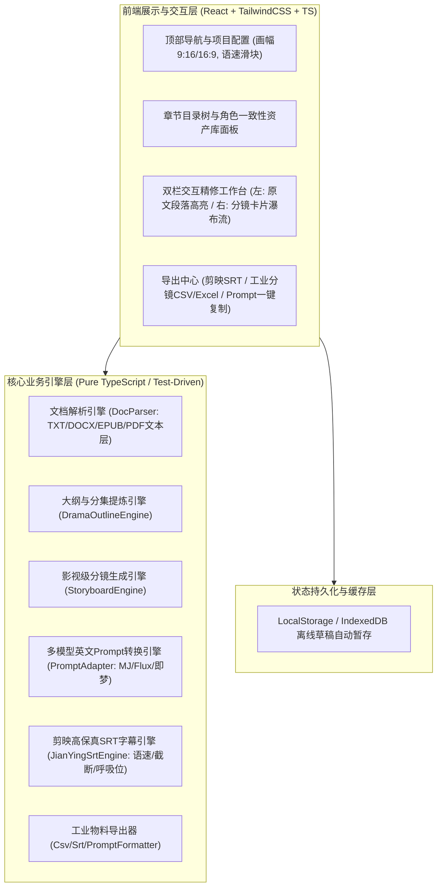

# 【技术方案设计】AI-StoryBoard-Studio 剧创智能分镜工场 (TRD)

| 文档版本 | 文档状态 | 编写人 | 评审日期 | 关联 PRD |
| :--- | :--- | :--- | :--- | :--- |
| V1.0.0 (MVP) | Approved (评审通过) | 研发架构师 | 2026-11-03 | [PRD-AI-StoryBoard-Studio.md](../prd/PRD-AI-StoryBoard-Studio.md) |

---

## 1. 架构总览与技术选型

### 1.1 系统目标与核心定位
本系统为 AI 短剧/漫剧制作团队提供从“原著长文本小说”到“影视级分镜脚本”、“多生图模型英文标准 Prompt”及“剪映标准 SRT”的全链路交付工作台。

### 1.2 技术选型规范（严格遵循项目规约）
- **核心开发语言**：**TypeScript 5.x 全栈覆盖**，严禁使用原生 JavaScript (`.js`)。
- **前端架构选型**：**React 18+ + TypeScript (.tsx) + TailwindCSS** 组件化与状态驱动架构。
- **构建与开发工具**：**Vite + React TS 模板**，支持热更新 (HMR)、无外部 CDN 强依赖、离线局域网开箱即用。
- **样式与设计体系**：**TailwindCSS** 原子化样式系统，打造专业暗色系影视工业调色台风格（Cinematic Dark Mode）。
- **图标系统**：Lucide-react，提供现代、极简的视听与剪辑控件图标。
- **单元与集成测试**：Node.js 原生测试套件 (`node --test`) 或 Vitest，测试代码全量命名为 `*.test.ts`。

### 1.3 架构全景图 (Architecture Overview)



---

## 2. 领域模型与数据契约 (TypeScript Data Contracts)

> **全局强制 TypeScript 规约**：所有核心业务实体与接口必须由严格的 TypeScript 类型声明先行。

### 2.1 核心类型定义 (`src/types/index.ts`)

```typescript
/**
 * 画面比例预设
 */
export type AspectRatio = '9:16' | '16:9';

/**
 * 景别枚举 (Shot Sizes)
 */
export type ShotSize =
  | 'Extreme Close-up' // 大特写
  | 'Close-up'         // 特写
  | 'Medium Close-up'  // 中近景
  | 'Medium Shot'      // 中景
  | 'Full Shot'        // 全景
  | 'Wide Shot'        // 远景/大远景
  | 'Over-the-shoulder'; // 过肩镜头

/**
 * 运镜与机位枚举 (Camera Movements & Angles)
 */
export type CameraMovement =
  | 'Static Eye-level'     // 平视定镜
  | 'Low-angle Dolly In'   // 低角度仰拍推镜
  | 'High-angle Tilt Down' // 俯拍下摇
  | 'Pan Following'        // 跟随摇镜
  | 'Tracking Shot'        // 移动追踪镜头
  | 'Arc Shot'             // 环绕运镜
  | 'Handheld Shaky';      // 手持呼吸感微晃

/**
 * 角色一致性资产模型
 */
export interface CharacterAsset {
  id: string;
  name: string;             // 角色中文名 (如: 顾北辰)
  roleType: 'protagonist' | 'antagonist' | 'supporting'; // 主角/反派/配角
  gender: 'male' | 'female' | 'other';
  ageGroup: string;         // 年龄段 (如: 28yo)
  appearancePrompt: string; // 锁定英文特征描述 (如: 28yo cold Asian male CEO, sharp jawline, short black hair, tailored charcoal suit)
  crefUrl?: string;         // Midjourney --cref 人物参考图链接 (可选)
}

/**
 * 多生图模型专属 Prompt
 */
export interface ModelPrompts {
  midjourney: string; // MJ v6.1 参数化 Prompt
  flux: string;       // Flux.1 自然语言长提示词
  jimeng: string;     // 即梦/通用双语精炼 Prompt
}

/**
 * 单个分镜镜头完整实体模型
 */
export interface StoryboardShot {
  id: string;
  shotNumber: number;          // 镜头序号 (1, 2, 3...)
  durationSec: number;         // 预估镜头时长 (秒)
  shotSize: ShotSize;          // 景别
  cameraMovement: CameraMovement; // 机位运镜
  characterAction: string;     // 角色表情与肢体动作
  characterIds: string[];      // 本镜头出场角色ID
  environmentLighting: string; // 环境场景与光影色调
  dialogue?: {                 // 对白台词
    speaker: string;           // 说话角色名
    text: string;              // 台词文本
    isVoiceover: boolean;      // 是否旁白/心理独白 (VO)
  };
  soundBgm: string;            // 音效/配乐氛围提示
  matchedSourceParagraph: string; // 映射的小说原著段落 (用于双栏联动高亮)
  prompts: ModelPrompts;       // 适配多生图模型的英文 Prompt
}

/**
 * 剧集大纲与梗概
 */
export interface EpisodeOutline {
  episodeNumber: number;
  title: string;
  hookOpening: string;         // 前 3 秒核心抓人钩子
  conflictEscalation: string;  // 1 分钟核心冲突
  cliffhangerEnding: string;   // 结尾悬念卡点
  rawContent: string;          // 本集小说原文本
  shots: StoryboardShot[];     // 该集所属分镜列表
}

/**
 * 原著文档解析结果
 */
export interface NovelDocument {
  id: string;
  fileName: string;
  fileSize: number;
  totalWords: number;
  chapters: {
    chapterIndex: number;
    title: string;
    content: string;
  }[];
}

/**
 * 剪映 SRT 导出配置
 */
export interface SrtExportConfig {
  charactersPerSecond: number; // 语速 (默认 4.5 字/秒)
  breathPauseSec: number;      // 句间呼吸停顿时长 (默认 0.35 秒)
  maxCharactersPerLine: number;// 单行最大安全字数 (默认 18 汉字)
  includeSpeakerName: boolean; // 是否包含说话人前缀 (如 "[顾北辰]:")
}

/**
 * 单条字幕条目
 */
export interface SubtitleItem {
  index: number;
  startTimeFormatted: string;  // 00:00:01,234
  endTimeFormatted: string;    // 00:00:03,850
  startMs: number;
  endMs: number;
  speaker?: string;
  text: string;
}
```

---

## 3. 核心算法设计与接口契约 (Core Engines)

### 3.1 剪映高保真 SRT 生成算法 (`JianYingSrtEngine`)
剪映对于字幕的毫秒精度与移动端折行极其敏感。算法核心逻辑如下：
1. **时间戳格式化规范**：毫秒必须是 3 位（补 0），时间格式形如 `HH:MM:SS,mmm`。
2. **动态语速基准计算**：
   $$\text{DurationMs} = \max\left(1000, \left(\frac{\text{CharLength}}{\text{CharactersPerSecond}}\right) \times 1000 + 300\right)$$
3. **移动端单行安全截断**：
   若对白文字长度超过 `maxCharactersPerLine`（默认 18 汉字），引擎自动寻找中间的标点符号（逗号、顿号、空格）切分为前后两条独立字幕段，按各自字数成比例分配时间轴，保证导入剪映后单屏居中无炸屏折行。

### 3.2 多模型提示词生成器 (`PromptAdapterEngine`)
针对同一分镜，动态生成三大模型标准英文提示词：
- **Midjourney 转换规则**：
  - 提取角色特征词注入主体；
  - 拼接镜头语言修饰词（如 `extreme close-up shot, low-angle dolly in`）；
  - 拼接场景光影与画质修饰词（`cinematic lighting, film grain, 8k, photorealistic`）；
  - 追加参数：`--ar 9:16 --v 6.1 --style raw`，若角色带有 cref 则追加 `--cref <url>`。
- **Flux.1 转换规则**：
  - 输出自然语言长句（Fluent Natural Language Paragraph），重点描述人物微表情细腻纹理（pores, catchlights in eyes）以及体积光（volumetric atmospheric haze）。
- **即梦 (Dreamina) 转换规则**：
  - 输出双语关键词短语，逗号隔开，符合中文大模型理解逻辑。

---

## 4. 前端组件设计 (React + TailwindCSS)

### 4.1 组件层级拓扑

```text
src/
├── components/
│   ├── Header.tsx              # 顶部导航栏、画幅切换 (9:16/16:9)、语速滑块控制、全局导出下拉菜单
│   ├── DocumentUploader.tsx    # 文件上传解析拖拽区、章节树展示
│   ├── CharacterManager.tsx    # 角色一致性管理抽屉 (角色卡片、Prompt特征词、--cref)
│   ├── StoryboardWorkspace.tsx # 核心双栏工作台
│   │   ├── SourceTextPane.tsx  # 左栏：原文剧本展示与当前激活分镜对应段落高亮
│   │   └── ShotCardList.tsx    # 右栏：分镜瀑布流卡片列表
│   │       └── ShotCardItem.tsx# 单个分镜卡片（景别/机位/光影/台词/MJ/Flux Tab切换）
│   ├── ExportModal.tsx         # 导出预览弹窗 (SRT 预览与下载、分镜表下载、一键复制 Prompt)
│   └── icons/                  # 现代化 Lucide 图标包装
├── engines/                    # 纯 TypeScript 核心计算与转换引擎
│   ├── docParser.ts            # 文档解析引擎
│   ├── promptAdapter.ts        # MJ / Flux / 即梦 提示词转换引擎
│   ├── srtGenerator.ts         # 剪映标准 SRT 生成与时间轴算法引擎
│   └── exportFormatter.ts      # CSV / Excel / TXT 导出工具
├── types/
│   └── index.ts                # 全局 TypeScript 契约声明
├── App.tsx                     # 主应用驱动与状态协调
└── main.tsx                    # React DOM 渲染入口
```

### 4.2 工业级暗色主题设计 (TailwindCSS)
- 背景基调：`bg-slate-950` / `bg-slate-900` 电影调色台深邃黑灰。
- 卡片层级：`bg-slate-800/80` 搭配 `border-slate-700/60` 与微发光边框。
- 高亮视觉：`amber-400` / `indigo-400` 原文高亮与聚焦光晕。
- 状态指示：`emerald-400` 导出就绪、`sky-400` 模型 Prompt 切换高亮。

---

## 5. 异常处理与容灾降级 (Fault Tolerance)

| 异常场景 | 检测方式 | 恢复/降级机制 |
| :--- | :--- | :--- |
| **纯扫描版图片 PDF** | 检测到文本层提取字符长度为 0 | 弹出友好提示 Modal，引导转换为带文本层 PDF 或 TXT，防止内存泄漏。 |
| **小说台词超长溢出** | 汉字字数 > 18 且缺少标点 | 算法按物理字数中值强制切分，时间戳连续递增，防止剪映折行炸屏。 |
| **分镜编辑数据丢失** | 用户不慎刷新或关闭网页 | `useEffect` 自动将当前项目状态序列化存入 `localStorage`，重新载入时秒级恢复。 |

---

## 6. 测试与验收策略 (TDD 闭环)

- **核心算法测试 (Red-Green)**：
  - `docParser.test.ts`：验证 TXT 章节自动切分与格式解析。
  - `promptAdapter.test.ts`：验证 Midjourney / Flux / 即梦 提示词及 9:16/16:9 画幅参数注入准确性。
  - `srtGenerator.test.ts`：验证剪映时间戳标准格式（`00:00:01,234`）、字数截断与语速计算。
- **测试命令统一规范**：使用 Node 原生测试运行器或 Vitest，命令均为针对 `*.test.ts` 执行。
