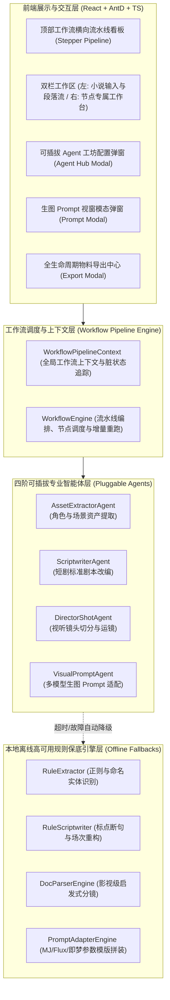

# 【技术方案设计】AI-StoryBoard-Studio 多智能体可插拔工作流分镜工场 (TRD)

| 文档版本 | 文档状态 | 编写人 | 评审日期 | 关联 PRD | 架构模式 |
| :--- | :--- | :--- | :--- | :--- | :--- |
| **V2.0.0** | Approved (开发闭环设计完成) | 架构师 / 全栈研发 | 2026-11-05 | [PRD-AI-StoryBoard-Studio.md](../prd/PRD-AI-StoryBoard-Studio.md) | **可插拔多智能体工作流 (Pluggable Multi-Agent Pipeline)** |

---

## 1. 架构总览与设计目标

### 1.1 系统上下文与演进目标
本系统承载短剧创作者从“原著小说长文本”到“工业级分镜”、“多生图模型 Prompt”与“剪映标准字幕”的全链路生成。
在 V2.0 架构中，系统从单体式大模型 Prompts 全量拆解彻底重构为**基于四阶解耦的多智能体流水线 (Multi-Agent Pipeline)**：
1. **资产提取 Agent (Asset Extractor)**：专注于原著人物名、外貌、穿搭与场景光影特征沉淀；
2. **剧本改编 Agent (Scriptwriter)**：专注于叙述文重构成规范影视短剧场次与对白；
3. **镜头切分 Agent (Director & Shot Division)**：专注于根据视听节奏切分镜头与机位运镜；
4. **生图 Prompt Agent (Visual Prompter)**：专注于深度融合角色 Trigger 与镜头构图，生成 Midjourney / Flux / 即梦多模型生图提示词。

### 1.2 全局强制规约（严格遵循 GEMINI.md）
- **TypeScript 100% 全栈覆盖**：核心引擎、工作流调度器、CLI、Server、React UI 与测试代码强制采用严格 TypeScript (`.ts` / `.tsx`)，严禁引入 JavaScript (`.js`)；
- **前端架构选型**：**React 18 + TypeScript + Ant Design (暗黑主题) + TailwindCSS**，彻底禁止纯原生 HTML + 原生 DOM 操作；
- **内网/离线免依赖**：所有基础依赖（React、ReactDOM、AntD、Dayjs、Babel）与规则引擎完全支持本地离线直接启动，无需外网 CDN 即可 100% 可用；
- **零阻断自愈门禁 (Zero-Block Fallback)**：每个 Agent 节点均实现两套执行器：**大模型推理执行器 (LLM Executor)** 与 **高性能本地离线规则执行器 (Offline Rule Fallback)**。当 API 超时、429 或残缺时无感降级，流程 100% 跑通；
- **自动化测试门禁**：测试用例一律命名为 `*.test.ts`，测试通过率必须保持 **100%（0 失败门禁）**。

### 1.3 系统架构全景图 (Multi-Agent Architecture)



---

## 2. 领域模型与数据契约 (TypeScript Data Contracts)

### 2.1 工作流核心上下文与阶段状态 (`src/types/workflow.ts`)

```typescript
import { AspectRatio, CharacterAsset, StoryboardShot } from './index';

/**
 * 流水线节点阶段定义
 */
export type PipelineStage = 'asset' | 'script' | 'shot' | 'prompt';

/**
 * 流水线节点执行状态
 */
export type StageStatus = 'idle' | 'running' | 'ready' | 'error' | 'skipped';

/**
 * 场景资产定义
 */
export interface SceneAsset {
  id: string;
  name: string;
  lightingAtmosphere: string;
  environmentPrompt: string;
}

/**
 * 短剧标准剧本场次契约
 */
export interface ScriptScene {
  sceneNumber: number;
  location: string;
  timeOfDay: 'DAY' | 'NIGHT' | 'DUSK' | 'DAWN';
  atmosphere: string;
  actionDescription: string;
  dialogues: Array<{
    speaker: string;
    emotion: string;
    text: string;
    isVoiceover: boolean;
  }>;
}

/**
 * Agent 独立插件配置
 */
export interface AgentPluginConfig {
  id: PipelineStage;
  name: string;
  enabled: boolean;
  llmConfig: {
    baseUrl: string;
    apiKey: string;
    model: string;
    temperature: number;
  };
  systemPromptTemplate?: string;
}

/**
 * 流水线完整上下文快照 (支持 LocalStorage 实时持久化)
 */
export interface WorkflowPipelineContext {
  novelText: string;
  aspectRatio: AspectRatio;
  stageStatuses: Record<PipelineStage, StageStatus>;
  dirtyFlags: Record<PipelineStage, boolean>; // 上游变更后的脏状态标记
  characters: CharacterAsset[];
  scenes: SceneAsset[];
  scriptScenes: ScriptScene[];
  shots: StoryboardShot[];
  agentConfigs: Record<PipelineStage, AgentPluginConfig>;
}
```

### 2.2 基础分镜与导出实体 (`src/types/index.ts`)
```typescript
export interface ModelPrompts {
  midjourney: string;
  flux: string;
  jimeng: string;
}

export interface StoryboardShot {
  id: string;
  shotNumber: number;
  durationSec: number;
  shotSize: 'Extreme Long Shot' | 'Wide Shot' | 'Medium Shot' | 'Close-up' | 'Extreme Close-up';
  cameraMovement: 'Static Eye-level' | 'Pan Left' | 'Slow Push-in' | 'Low-angle Tracking' | 'High-angle';
  characterAction: string;
  characterIds: string[];
  environmentLighting: string;
  dialogue?: {
    speaker: string;
    text: string;
    isVoiceover?: boolean;
  };
  soundBgm?: string;
  matchedSourceParagraph?: string;
  prompts: ModelPrompts;
}
```

---

## 3. 核心接口与协议规范 (API Contracts & Signatures)

### 3.1 服务端 REST API 契约 (`src/server.ts`)

| 接口名称 | 方法与路径 | 入参结构 | 返回结构 | 说明 |
| :--- | :--- | :--- | :--- | :--- |
| **一键运行全流水线** | `POST /api/v1/workflow/run-all` | `{ novelText, characters?, aspectRatio?, agentConfigs? }` | `{ code: 0, data: WorkflowPipelineContext }` | 依次串行执行4大Agent，遇跳过节点自动穿透 |
| **单节点独立重跑** | `POST /api/v1/workflow/run-stage` | `{ stage: PipelineStage, context: WorkflowPipelineContext }` | `{ code: 0, data: Partial<WorkflowPipelineContext> }` | 仅重跑指定阶段并更新对应上下文与脏状态 |
| **单镜头指令润色** | `POST /api/v1/ai-refine` | `{ shot, userInstruction, characters, aspectRatio, llmConfig }` | `{ code: 0, data: { shot: StoryboardShot } }` | 保持原有单镜头导演指令润色 |
| **剪映字幕计算导出** | `POST /api/v1/srt` | `{ shots, config: { speedWps, includeSpeaker } }` | `{ code: 0, data: { srtText, items } }` | 高保真剪映 SRT 实时计算与导出 |

### 3.2 Agent 统一抽象接口 (`src/engines/agents/baseAgent.ts`)

```typescript
export interface IAgent<TInput, TOutput> {
  readonly stage: PipelineStage;
  readonly defaultName: string;

  /**
   * 执行核心业务逻辑，具备自动保底降级
   */
  execute(
    input: TInput,
    config: AgentPluginConfig,
    context: WorkflowPipelineContext
  ): Promise<{ data: TOutput; isFallback: boolean; message?: string }>;

  /**
   * 纯离线保底计算器
   */
  fallback(input: TInput, context: WorkflowPipelineContext): TOutput;
}
```

---

## 4. 关键技术实现与算法逻辑

### 4.1 四大 Agent 实现方案
1. **AssetExtractorAgent (`src/engines/agents/assetExtractor.ts`)**：
   - **LLM Prompt 设计**：输入小说正文，严格提取核心人物（姓名、性别、年龄、外貌长相、发型、典型穿搭、性格气质）与场景光影，输出标准 JSON；
   - **离线降级 (Fallback)**：使用命名实体词性正则与引号引语前缀匹配出角色名，自动拼装基础都市/古风通用穿搭与冷峻光影 Trigger Prompt。
2. **ScriptwriterAgent (`src/engines/agents/scriptwriter.ts`)**：
   - **LLM Prompt 设计**：将网文大段心理活动与旁白改写为影视短剧标准场次（内景/外景、日夜时标、视觉化动作动作、言简意赅戏剧对白）；
   - **离线降级 (Fallback)**：基于段落断句算法，将含有对白的句子提取为对白，将叙事句子提取为环境动作描写，组合成标准场次。
3. **DirectorShotAgent (`src/engines/agents/directorShot.ts`)**：
   - **LLM Prompt 设计**：遵循黄金短剧节奏，按动作与情绪爆发点切分镜头（大特写、近景、中景、远景与推进运镜）；
   - **离线降级 (Fallback)**：深度包装现有的 `DocParserEngine`，按视听启发式规则与标点卡点切分分镜。
4. **VisualPromptAgent (`src/engines/agents/visualPrompt.ts`)**：
   - **LLM Prompt 设计**：将镜头与角色库精准对齐，生成 Midjourney（带 `--ar 9:16 --v 6.1 --style raw --cref`）、Flux.1（自然语言长文质感）与即梦（双语精炼）；
   - **离线降级 (Fallback)**：调用 `PromptAdapterEngine` 进行确定性的参数模版构造。

### 4.2 智能版本标记与增量更新策略
- 上游（如第 1 阶资产）被用户手动修改后，`dirtyFlags.script = true`, `dirtyFlags.shot = true`, `dirtyFlags.prompt = true`；
- 当触发「增量更新 (Incremental Refresh)」时：
  - 保留下游分镜已有的 `shotNumber`、`shotSize`、`cameraMovement`、`characterAction`、`dialogue`；
  - 仅拉取最新的角色 `appearancePrompt`、`costumePrompt` 与 `crefUrl`，重新调用 `VisualPromptAgent` 刷新 `prompts`，彻底防止用户已人工润色的镜头与台词被冲毁！

---

## 5. 异常处理与容灾降级矩阵 (Fault Tolerance)

| 异常场景 | 检测方式 | 自愈/容灾策略 |
| :--- | :--- | :--- |
| **大模型 API 超时 (>15s) 或断网** | `AbortSignal.timeout` 捕获 `TimeoutError` | 自动切换为对应 Agent 的本地离线规则引擎，状态标记为就绪，Toast 提示已保底 |
| **第三方 API 404 / 429 限流 / Key 无效** | HTTP Response Status >= 400 | 捕获 HTTP 状态码，记录控制台警告，调用本地离线算法保底输出 |
| **大模型返回 Markdown 杂质或格式残缺** | JSON 正则清洗提取失败 | 自动启用 `extractJsonFromResponse` 容错提取，若仍失败则转离线保底 |
| **前置 Agent 被用户主动跳过 (Skip)** | `agentConfig.enabled === false` | 开启直通输入（如跳过剧本 Agent 时，输入框自动作为剧本直接送入镜头 Agent） |
| **浏览器意外刷新或崩溃** | 前端挂载首屏检测 | `localStorage` 恢复 `asbs_workflow_context`，草稿与生成态 100% 恢复 |

---

## 6. 部署架构与研发实施环境
- **开发与运行环境**：Node.js 20+（原生 TypeScript 执行支持）、Pnpm；
- **前端打包模式**：支持独立单页面免打包开箱即用（`src/ui/index.html` 直接挂载 React + Babel + AntD 离线 Vendor）；
- **测试框架**：Node.js 原生 Test Runner（`node --test projects/AI-StoryBoard-Studio/tests/*.test.ts`）。
