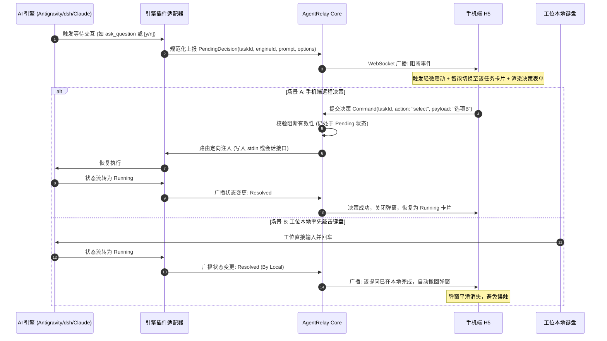
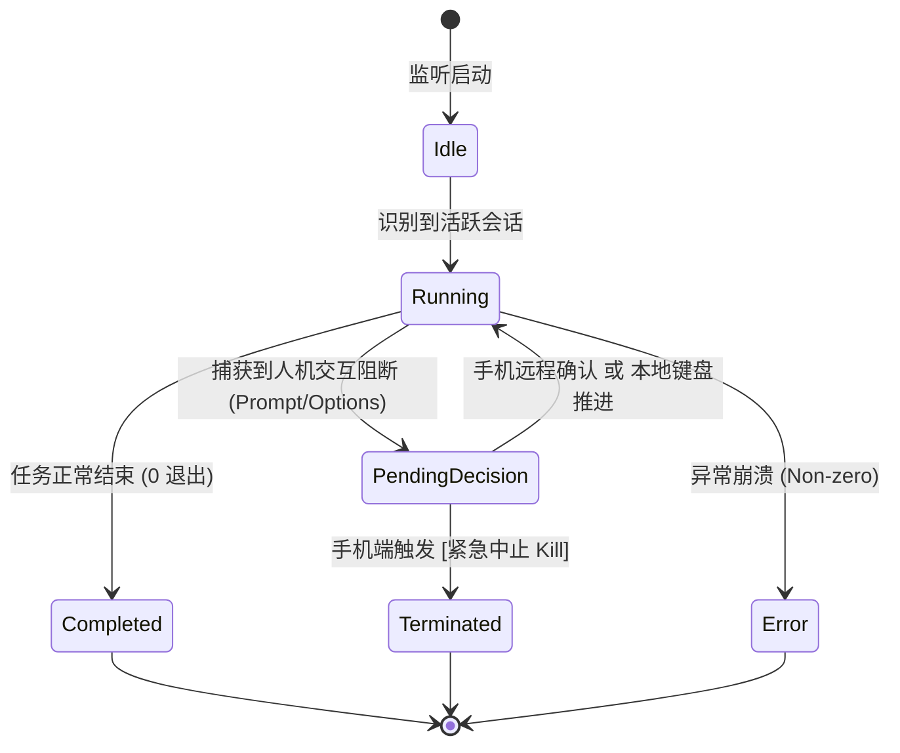

# 【产品需求文档】AgentRelay 多 AI 引擎可插拔扩展 (PRD)

| 文档版本 | 文档状态 | 编写人 | 创建日期 | 评审状态 |
| :--- | :--- | :--- | :--- | :--- |
| **V1.1.0** | Ready for Review | 产品经理 | 2026-10-26 | 待研发评审 |

---

## 1. 需求背景与业务价值

### 1.1 业务背景与问题痛点
在工位电脑执行长耗时任务时，开发者不再局限于单一的 `claude-code`，而是高频使用多样化的自主型编程与任务智能体：
1. **Antigravity**：具备强大的系统级工作流编排、Subagent 协同以及基于 `ask_question` 的结构化问答阻断；
2. **dsh (DeepSeek Harness)**：国内常用、基于高推理性能的开源/自主编程框架，主要基于终端 PTY 提示符驱动；
3. **Claude Code**：基于 Anthropic 原生 CLI 的交互式编程助手。

**当前痛点**：
- **引擎单一绑定**：现有 AgentRelay V1.0 仅深度耦合了 `ClaudeWatcher`，无法监控和接管 `Antigravity` 与 `dsh`；
- **架构扩展困难**：若每新增一个 AI 引擎都要侵入式修改 CLI 核心调度逻辑，研发维护成本极高，无法应对未来更多新工具（如 Aider、Devin、Cursor CLI 等）的快速接入；
- **交互异构难以统一**：不同引擎的提问形式截然不同（Antigravity 为结构化 JSON 多选/单选，dsh 为原生 CLI 提示符，Claude 为行级确认），手机端缺乏自适应渲染层。

### 1.2 业务目标与价值衡量 (Success Metrics)
- **核心目标**：
  将 AgentRelay 重构为**可插拔式多引擎中继伴侣架构 (Pluggable Multi-Engine Agent Relay)**，支持统一监控 `claude-code`、`antigravity`、`dsh` 及未来扩展引擎，提供统一的多任务切换看版与自适应决策响应。
- **衡量指标**：
  - **新引擎接入研发工时**：新增一款标准 AI 引擎的适配开发时间从 > 2 天缩减至 < 2 小时（仅需编写轻量声明式规则或独立 Adapter）。
  - **多引擎阻断覆盖率**：针对工位上 Antigravity、dsh、Claude Code 的人工阻断事件，手机端捕获率达到 **99.5% 以上**。
  - **误操作/冲突率**：双端（工位本地键盘 vs 手机远程点击）同时操作时的冲突率降低至 **0%**（自动撤销阻断弹窗与精确会话隔离）。

---

## 2. 目标用户画像

| 角色画像 | 核心痛点与诉求 | 使用频次 |
| :--- | :--- | :--- |
| **全栈研发工程师 (Dev)** | 经常在工位多窗口并行运行 Antigravity 自动化重构与 Claude/dsh 脚本测试，下班后需随时掌握两者的执行进度并在手机上一键推进。 | 高频（每日下班后及周末） |
| **产品经理 (PM)** | 运行 Antigravity 生成 PRD、方案推演或跑原型批量测试，遇方案选择（单选/多选题）时需在移动端优雅确认。 | 中高频（发版或方案论证期） |
| **DevOps / 工具链维护者** | 需要灵活开启、关闭或自定义部门内部专属的 AI 命令行工具接入规则，要求零核心代码修改。 | 低频配置（一次配置，长期使用） |

---

## 3. 需求边界与范围 (In-Scope vs Non-Goals)

### 3.1 本期包含范围 (In-Scope - V1.1.0)
- [x] **可插拔引擎体系 (Pluggable Engine Architecture)**：
  - 提供声明式引擎配置规范（`config/engines.json`），支持定义引擎 ID、启用开关、探测模式、路径模式与阻断匹配规则。
  - 支持引擎配置热重载（Hot-Reload），无需重启 CLI。
- [x] **三款核心 AI 引擎官方适配器**：
  - **Antigravity 适配器**：解析 `brain/<conv-id>/.system_generated/logs/transcript.jsonl`，精确捕获 `ask_question` 结构化题目与多项选项；
  - **dsh (DeepSeek Harness) 适配器**：基于 PTY 终端流与流式日志正则规则，智能感知终端 `[y/n]`、回车及参数输入提示；
  - **Claude Code 适配器**：继承现有成熟能力，抽象为统一 Plugin 接口。
- [x] **统一自动嗅探 (Engine Auto-Detect)**：
  - 启动 `relay watch <dir>` 时，系统自动根据工作区特征指纹（如 `.gemini/`、`~/.claude/`、`dsh` 进程等）自动装载对应适配器。
- [x] **移动端多任务自适应看板 (Multi-Task Smart Focus)**：
  - 顶部多任务横滑卡片与状态徽标；
  - 任意引擎阻断时自动触发智能聚焦（Smart Focus）与震动提醒；
  - 自适应决策卡片：结构化单选/多选动态渲染，通用 Y/N/Enter 兜底，常驻紧急中止 (Kill)。
- [x] **双端防竞争与精准路由**：
  - 本地已操作时，手机端自动静默撤回决策弹窗；
  - 指令下发携带 `taskId / engineId`，绝对隔离执行通道。

### 3.2 明确不做的范围 (Non-Goals)
- ❌ **移动端不提供从零发起新引擎任务的能力**：仍遵循“工位开启，手机守望”的轻量定位。
- ❌ **不做各引擎专属复杂参数调优界面**：不向手机端开放 Temperature、Top-P、模型切片等高级参数配置。
- ❌ **不做全量终端 PTY 终端模拟器 (xterm.js)**：保持轻量卡片式交互，避免大流量消耗与移动端键盘交互灾难。

---

## 4. 业务流程与架构设计

### 4.1 系统整体架构

```mermaid
flowchart TD
    subgraph Host["工位主机 (PC AgentRelay)"]
        subgraph EngineLayer["可插拔引擎层 (Pluggable Engine Layer)"]
            E_Claude["Claude Code 适配器\n(JSONL Transcript)"]
            E_Anti["Antigravity 适配器\n(Transcript & ask_question)"]
            E_Dsh["dsh 适配器\n(PTY / Stream Regex)"]
            E_Custom["自定义扩展引擎\n(声明式 engines.json)"]
        end

        Router["统一调度与路由中心 (Relay Core Router)"]
        ConfigMgr["配置管理器 (Hot-Reload)"]
        Deconflict["双端冲突裁决器 (De-conflict Engine)"]
        Sanitizer["合规脱敏管道 (Data Sanitizer)"]
        WSServer["WebSocket / HTTP 中继服务"]

        ConfigMgr -->|加载/热重载| EngineLayer
        EngineLayer -->|统一规范事件| Router
        Router --> Deconflict
        Deconflict --> Sanitizer
        Sanitizer --> WSServer
    end

    subgraph Mobile["手机端 (Mobile H5 / 小程序)"]
        MultiCard["多任务横滑卡片看板"]
        SmartFocus["智能聚焦调度器 (Pending 优先)"]
        FormRenderer["自适应决策渲染引擎\n(结构化选项 / 通用按键)"]
    end

    WSServer <===>|公网安全穿透 (WSS)| Mobile
```

### 4.2 阻断捕获与双端响应时序



### 4.3 任务状态机定义



---

## 5. 功能需求详细规格 (Feature Breakdown)

### 模块一：可插拔引擎体系与配置管理

#### [F-01] 声明式引擎插件配置 (P0)
- **需求描述**：
  在系统目录内置 `config/engines.json`，允许声明启用、禁用及扩展引擎适配规则。
- **配置数据结构规范**：
  ```json
  {
    "engines": [
      {
        "id": "antigravity",
        "name": "Google Antigravity",
        "enabled": true,
        "type": "transcript_file",
        "config": {
          "logPathPattern": "%APPDATA%\\.gemini\\antigravity\\brain\\*\\.system_generated\\logs\\transcript.jsonl",
          "extractType": "antigravity_jsonl"
        }
      },
      {
        "id": "dsh",
        "name": "DeepSeek Harness",
        "enabled": true,
        "type": "process_pty",
        "config": {
          "processPatterns": ["dsh", "deepseek-harness"],
          "promptMatchers": [
            { "regex": "\\[y/n\\]", "type": "confirm" },
            { "regex": "Select option \\[(\\d+)-(\\d+)\\]", "type": "number_select" },
            { "regex": "(Press ENTER to continue|按回车继续)", "type": "enter_continue" }
          ]
        }
      },
      {
        "id": "claude",
        "name": "Claude Code",
        "enabled": true,
        "type": "transcript_file",
        "config": {
          "logPathPattern": "~/.claude/projects/*/*.jsonl"
        }
      }
    ]
  }
  ```
- **业务规则**：
  1. 系统启动时遍历所有 `enabled: true` 的引擎规则。
  2. 支持利用文件监听器（`fs.watch`）对 `engines.json` 进行热重载，检测到配置文件修改后自动重新注册插件，现有任务连接不受影响。

---

### 模块二：三大官方引擎专用适配器规格

#### [F-02] Antigravity 专有适配器 (P0)
- **前置条件**：检测到目标工作区或全局正在运行 Antigravity 任务。
- **日志监听通道**：
  实时增量读取 `%APPDATA%\.gemini\antigravity\brain\<conversation-id>\.system_generated\logs\transcript.jsonl`。
- **阻断特征提取规则**：
  - 当读取到步骤类型包含 `tool_calls` 且调用 `ask_question` 时：
    - 提取 `questions[].question` 作为主问题文本；
    - 提取 `questions[].options` 数组作为交互式单选/多选候选值；
    - 提取 `questions[].is_multi_select` 作为单选/多选标识。
  - 任务状态即刻流转为 `PendingDecision`。
- **决策注入行为**：
  - 手机端提交选项后，适配器根据协议回填答案至对应 session 的回答通道，推动 Antigravity 继续执行。

#### [F-03] dsh (DeepSeek Harness) 专有适配器 (P0)
- **前置条件**：通过 `relay run "dsh ..."` 托管运行，或通过进程树嗅探捕获终端输出。
- **阻断特征提取规则**：
  - 针对 ANSI 终端输出流应用 ANSI 字符剥离；
  - 匹配尾部 3 行文本是否命中 `promptMatchers`：
    - `[y/n]` 确认模式；
    - 路径/数字选择提示模式；
    - 回车等待模式；
  - 连续空闲静默（Idle）超过 1.5 秒且尾部命中正则时，标记为 `PendingDecision`。
- **决策注入行为**：
  - 手机点击 `[同意 Y]` -> 写入 `y\n` 到 PTY 子进程 stdin；
  - 手机点击 `[拒绝 N]` -> 写入 `n\n`；
  - 手机输入自定义文本 -> 写入 `<文本>\n`。

#### [F-04] Claude Code 适配器重构 (P0)
- **需求描述**：
  将现有 `claude_watcher.ts` 重构成标准 `EngineAdapter` 接口实现，保持原有功能 100% 兼容。

---

### 模块三：移动端多任务自适应看板

#### [F-05] 移动端多任务切换与智能聚焦 (P0)
- **页面布局**：
  - **顶部任务导航栏**：横滑展示当前工位所有活跃任务（带引擎 Logo 标签、项目名称、运行状态徽标）；
  - **智能聚焦机制**：当任意后台任务状态由 `Running` 变为 `PendingDecision` 时，界面自动播放轻微提示音并震动，视窗自动聚焦并高亮该任务卡片；
  - **状态指示灯**：
    - 🟢 绿色脉冲：`Running` 正在运算与工具执行
    - 🟡 黄色闪烁：`PendingDecision` 阻塞等待人工介入
    - ⚪ 灰色常亮：`Completed` 正常结束
    - 🔴 红色常亮：`Error / Killed` 异常中止

#### [F-06] 自适应决策卡片 (Universal Decision Form) (P0)
- **表单动态渲染逻辑**：
  ```mermaid
  flowchart TD
      CheckOptions{是否存在结构化选项?}
      CheckOptions -->|是 (如 Antigravity)| RenderOptions[渲染大字号单选/多选按钮组]
      CheckOptions -->|否 (如 dsh/通用)| RenderDefault[渲染标准三键: [同意 Y] [拒绝 N] [回车 Enter]]
      RenderOptions --> AppendTextInput[附带自由补充文本框]
      RenderDefault --> AppendTextInput
      AppendTextInput --> AppendKillBtn[底部常驻红边框 [紧急中止 Kill] 按钮]
  ```
- **交互规范**：
  - 选项按钮触摸反馈灵敏（最小点击热区 ≥ 48px），支持点击后二次防抖，防止短时间重复多次点击。

#### [F-07] 双端防重与自动撤回 (P0)
- **处理规则**：
  1. 当手机端正处于阻断决策界面时，若引擎适配器检测到会话已前行（被工位本地操作推进）：
  2. 手机端即刻平滑收起弹窗，并展示轻量 Toast 提示：“*检测到该步骤已在本地处理完毕*”；
  3. 若手机端点击提交的瞬间正好撞车，后台校验阻断已失效，返回状态码 409，不进行二次注入，防止错误字符污染后续终端命令。

---

## 6. 非功能性需求 (NFR)

### 6.1 性能与资源开销
- **空闲 CPU 占用**：PC 端同时守望 3 个引擎时，后台进程 CPU 占用率 ≤ **1.5%**；
- **内存消耗**：PC 端常驻内存 ≤ **50MB**；
- **事件上报延迟**：从引擎产生阻断到手机端震动提示，内网穿透链路端到端延迟 ≤ **800ms**。

### 6.2 安全合规基线 (数据红线)
- **脱敏管道 (Data Sanitizer)**：
  - 任何引擎产生的日志内容，仅截取阻断提问上下文及最近 **15 行**纯文本摘要；
  - 严禁向公网传输源代码全文、Git Diff 全文或敏感密钥（检测并屏蔽 API-KEY / Token 样式的字符串）。

### 6.3 平台与终端兼容性
- **PC 宿主端**：支持 Windows 10/11 (PowerShell/CMD)、macOS (zsh/bash)、Linux。
- **移动端**：完美适配 iOS Safari、微信内置内置浏览器、Android Chrome，遵循移动端视口动态高度 (`100dvh`)，键盘弹起不遮挡提交按钮。

---

## 7. 交付计划与研发里程碑

| 阶段 | 交付物 | 周期预估 | 验收标准 |
| :--- | :--- | :--- | :--- |
| **Milestone 1** | 核心架构重构：可插拔适配器接口定义 + `engines.json` 配置解析与热重载 | 1 天 | 单元测试通过，配置变动能够实时触发引擎装载/卸载 |
| **Milestone 2** | Antigravity 适配器与 dsh 适配器开发 | 1.5 天 | 自动化测试用例模拟两类阻断，100% 正确捕获并解析 |
| **Milestone 3** | 手机端多任务看板与自适应表单升级 (Vue 3/TSX) | 1.5 天 | 手机多卡片切换丝滑，结构化选项与通用按键自适应渲染 |
| **Milestone 4** | 双端防竞争联调、穿透压力测试与全链路回归 | 1 天 | 模拟双端同时抢跑 0 冲突，PC 端防休眠在多任务下正常维系 |

---

## 8. 附录：核心接口模型草案 (TypeScript)

```typescript
export interface EnginePluginConfig {
  id: string;
  name: string;
  enabled: boolean;
  type: 'transcript_file' | 'process_pty' | 'custom';
  config: Record<string, any>;
}

export interface DecisionOption {
  id: string | number;
  label: string;
  isRecommended?: boolean;
}

export interface PendingDecision {
  taskId: string;
  engineId: string;
  engineName: string;
  title: string;
  question: string;
  isMultiSelect: boolean;
  options?: DecisionOption[];
  timestamp: number;
}

export interface IEngineAdapter {
  id: string;
  name: string;
  init(config: Record<string, any>): Promise<void>;
  startWatch(targetPath: string): void;
  stopWatch(): void;
  injectDecision(taskId: string, answer: string | string[]): Promise<boolean>;
  killTask(taskId: string): Promise<boolean>;
  on(event: 'decision_needed', listener: (decision: PendingDecision) => void): this;
  on(event: 'decision_resolved', listener: (taskId: string) => void): this;
  on(event: 'log_update', listener: (log: string) => void): this;
}
```
