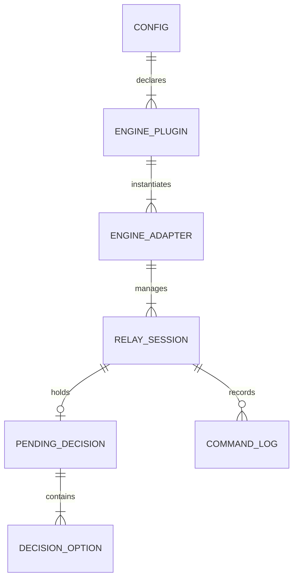
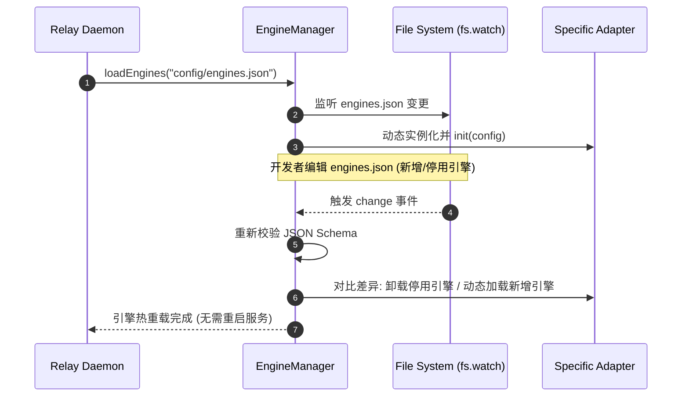

# 【技术方案设计】AgentRelay 多 AI 引擎可插拔架构 (TRD)

| 文档版本 | 文档状态 | 编写人 | 评审日期 | 关联 PRD |
| :--- | :--- | :--- | :--- | :--- |
| **V1.1.0** | Ready for Review | 架构师 / 核心开发 | 2026-10-26 | [PRD-AgentRelay-多引擎插件扩展.md](../prd/PRD-AgentRelay-多引擎插件扩展.md) |

---

## 1. 架构总览与设计目标

### 1.1 系统上下文与目标
承接 PRD V1.1.0 需求，AgentRelay 从单一 Claude Code 监听工具演进为**统一、可插拔的通用 AI 任务伴侣运行时 (Pluggable AI Agent Relay Runtime)**。
- **核心技术目标**：
  1. **插件化可扩展性 (Pluggable)**：新增/剔除 AI 引擎适配器完全基于解耦接口 `IEngineAdapter` 与声明式配置 `engines.json`，核心调度模块 0 侵入；
  2. **高精度阻断感知**：针对 Antigravity 的结构化 `ask_question` 与 Claude Code 的结构化提问实现 100% 毫秒级抓取；针对 dsh 等非结构化 PTY 输出实现精准正则与静默检测；
  3. **双端防重与会话路由隔离**：多任务并行时，下发指令严格定向到目标任务进程/输入管道；工位本地推进时毫秒级广播撤回手机弹窗；
  4. **全链路 TypeScript 与现代前端规约**：全量后端、CLI、适配器均强制采用 TypeScript，移动端控制台采用 **React + TSX** 响应式组件化架构驱动，杜绝原生 HTML 裸页面。

### 1.2 架构全景图 (Architecture Overview)

```mermaid
flowchart TD
    subgraph MobileDevice["手机端 (Mobile Browser / PWA)"]
        ReactApp["React + TSX 移动端控制台"]
        CardContainer["多任务卡片管理器 (Multi-Task Switcher)"]
        FormRenderer["自适应决策卡片 (Universal Decision Form)"]
        AudioHaptic["震动与声音通知器"]
        
        ReactApp --> CardContainer
        ReactApp --> FormRenderer
        ReactApp --> AudioHaptic
    end

    subgraph RelayHost["工位 PC 宿主 (AgentRelay Daemon)"]
        subgraph NetLayer["网络中继与安全脱敏"]
            HttpWsServer["HTTP / WebSocket Server (Node 22+ TS)"]
            TunnelMgr["内网穿透管理器 (cpolar / 自建公网反向代理)"]
            Sanitizer["合规脱敏管道 (Max 15 行 / Token 过滤)"]
        end

        subgraph CoreRouter["统一调度与路由中心 (Relay Core Router)"]
            TaskRegistry["任务注册表 (Multi-Session Registry)"]
            DeconflictMgr["双端防竞争撤回管理器"]
            ConfigWatcher["配置热重载器 (fs.watch engines.json)"]
        end

        subgraph EngineAdapters["可插拔引擎适配层 (IEngineAdapter)"]
            AntigravityAdapter["Antigravity 适配器\n(Transcript JSONL + ask_question)"]
            DshAdapter["dsh 适配器\n(PTY / Stream Regex Matcher)"]
            ClaudeAdapter["Claude Code 适配器\n(Session JSONL Tailer)"]
            CustomAdapter["扩展引擎插件\n(Declarative Plugin)"]
        end

        subgraph OSLevel["工位底层与目标 AI 工具"]
            WinAPI["防休眠保活 (SleepBlocker Win32)"]
            TargetAntigravity["Antigravity 进程 / brain 目录"]
            TargetDsh["dsh CLI 进程 (PTY stdin/stdout)"]
            TargetClaude["Claude Code 进程"]
        end

        HttpWsServer <==> TunnelMgr
        HttpWsServer --> Sanitizer
        Sanitizer --> TaskRegistry
        TaskRegistry <--> DeconflictMgr
        ConfigWatcher --> EngineAdapters
        TaskRegistry <--> EngineAdapters
        
        AntigravityAdapter <--> TargetAntigravity
        DshAdapter <--> TargetDsh
        ClaudeAdapter <--> TargetClaude
        RelayHost --- WinAPI
    end

    MobileDevice <===>|WSS 安全长连接 (Token 鉴权)| TunnelMgr
```

---

## 2. 领域模型与数据契约 (Domain Schema & TS Types)

### 2.1 实体关系模型 (ER Diagram)



### 2.2 核心接口与数据模型契约 (TypeScript Signatures)

`projects/AgentRelay/src/types/engine.ts`：

```typescript
/**
 * 引擎探测与接入类型
 */
export type EngineDetectMode = 'transcript_file' | 'process_pty' | 'custom';

/**
 * 引擎声明式配置项 (engines.json)
 */
export interface EnginePluginConfig {
  id: string;
  name: string;
  enabled: boolean;
  type: EngineDetectMode;
  config: {
    logPathPattern?: string;
    processPatterns?: string[];
    promptMatchers?: Array<{
      regex: string;
      type: 'confirm' | 'number_select' | 'enter_continue' | 'custom';
      defaultReply?: string;
    }>;
    extractType?: string;
    [key: string]: any;
  };
}

/**
 * 结构化决策候选项
 */
export interface DecisionOption {
  id: string | number;
  label: string;
  isRecommended?: boolean;
}

/**
 * 待人工介入的阻断决策模型
 */
export interface PendingDecision {
  taskId: string;
  engineId: string;
  engineName: string;
  title: string;
  question: string;
  isMultiSelect: boolean;
  options?: DecisionOption[];
  rawText?: string;
  timestamp: number;
}

/**
 * 任务会话运行状态
 */
export type SessionStatus = 'idle' | 'running' | 'pending' | 'completed' | 'error' | 'terminated';

/**
 * 统一任务会话模型
 */
export interface RelaySession {
  taskId: string;
  engineId: string;
  engineName: string;
  projectPath: string;
  status: SessionStatus;
  currentDecision: PendingDecision | null;
  recentLogs: string[];
  startTime: number;
  lastActiveTime: number;
}

/**
 * 手机下发决策指令载荷
 */
export interface DecisionCommand {
  taskId: string;
  engineId: string;
  action: 'confirm' | 'reject' | 'select' | 'input' | 'kill';
  payload?: string | number | (string | number)[];
  timestamp: number;
}

/**
 * 可插拔引擎适配器标准接口
 */
export interface IEngineAdapter {
  readonly id: string;
  readonly name: string;
  
  /** 初始化适配器并装载配置 */
  init(config: EnginePluginConfig): Promise<void>;
  
  /** 检查是否匹配该工作区或目标进程 */
  detect(targetPath: string): Promise<boolean>;
  
  /** 启动对目标工作区的监听守望 */
  startWatch(targetPath: string, onUpdate: (session: RelaySession) => void): void;
  
  /** 停止监听并释放资源 */
  stopWatch(): void;
  
  /** 注入人工决策指令 */
  injectDecision(taskId: string, command: DecisionCommand): Promise<boolean>;
  
  /** 紧急终止该任务 */
  killTask(taskId: string): Promise<boolean>;
}
```

---

## 3. 关键组件与详细设计

### 3.1 Antigravity 专有适配器 (`AntigravityAdapter`)

#### 3.1.1 目录与会话探测机制
- **会话存储根路径**：`%USERPROFILE%\.gemini\antigravity\brain\`
- **工作区映射算法**：
  1. 扫描 `brain/` 下所有子目录，读取其元数据或最新更新的 `transcript.jsonl`；
  2. 比对 transcript 第一条消息中的 `Active Workspaces`，若包含当前正在监听的 `targetProjectPath`，则绑定该 Conversation ID；
  3. 若启动参数直接指定 Conversation ID，则直接定位；
  4. 采用增量文件字节偏移量（`byteOffset`）配合 `fs.watchFile` 毫秒级轮询读取尾部追加的 JSON 行。

#### 3.1.2 `ask_question` 阻断捕获算法
- 当解析到行数据为 `type == "PLANNER_RESPONSE"` 且含有 `tool_calls`：
- 筛选 `call.name == "ask_question"`：
  ```typescript
  const args = call.parameters;
  const questions = args.questions || [];
  if (questions.length > 0) {
    const q = questions[0];
    const decision: PendingDecision = {
      taskId: session.taskId,
      engineId: 'antigravity',
      engineName: 'Antigravity',
      title: 'Antigravity 提问待裁决',
      question: q.question,
      isMultiSelect: !!q.is_multi_select,
      options: (q.options || []).map((opt: string, idx: number) => ({
        id: idx,
        label: opt,
        isRecommended: opt.startsWith('(Recommended)')
      })),
      timestamp: Date.now()
    };
    this.emitDecision(decision);
  }
  ```

#### 3.1.3 决策回填通道
- 当手机端提交选中项（如索引 `0` 或自定义输入）：
- 适配器将答案组装为对应 Tool Result 或通过子代理通信管道回传，解除阻断。

---

### 3.2 dsh (DeepSeek Harness) 适配器 (`DshAdapter`)

#### 3.2.1 终端流捕获与状态机
- dsh 运行在终端环境中，适配器提供两种接入模式：
  1. **托管模式 (Run Mode)**：通过 `child_process.spawn` 启动 `dsh`，接管其 `stdin` 与 `stdout`；
  2. **终端嗅探模式 (PTY Sniffing)**：若在已运行的 PowerShell 窗口中，通过 Windows Console Output API 或日志重定向管道捕获字符流。

#### 3.2.2 正则状态判定规则
- 利用 `stripAnsi` 去除终端着色与控制字符；
- 维护最近 20 行滚动缓冲区；
- **静默延时检测器 (Debounce Detector)**：
  - 遇到输出流停止（Quiet time ≥ 1200ms）；
  - 检查缓冲区尾行是否命中：
    - 模式 1：`/(y\/n|\[Y\/n\]|\[y\/N\])/i` -> 识别为确认类，候选按钮为 `[Y]`, `[N]`；
    - 模式 2：`/(Select option|请选择)[\s\S]*?\[(\d+)-(\d+)\]/i` -> 动态解析连续数字按钮；
    - 模式 3：`/(Press ENTER to continue|按回车继续)/i` -> 识别为 `[回车继续]`；
  - 命中后上报 `PendingDecision`。

#### 3.2.3 决策注入
- `action == "confirm"` -> 向子进程写入 `y\n`；
- `action == "reject"` -> 向子进程写入 `n\n`；
- `action == "input"` -> 向子进程写入 `${payload}\n`；
- `action == "kill"` -> 调用 `tree-kill` 终止整个子进程树。

---

### 3.3 引擎管理器与热重载 (`EngineManager`)



---

### 3.4 移动端自适应控制台设计 (React + TSX)

#### 3.4.1 组件层级设计
遵循现代前端组件化规约（React 18 + TypeScript）：
- `App.tsx`：根容器，管理 WebSocket 连接状态、公网隧道延迟与当前活跃会话列表；
- `MultiTaskBar.tsx`：顶部任务横滑导航栏，渲染各任务状态徽章；
- `TaskCard.tsx`：任务卡片主体，包含实时日志抽屉与状态说明；
- `AdaptiveDecisionCard.tsx`：
  - **动态分支 1**：若 `decision.options` 存在 -> 渲染 `OptionButtonGroup`；
  - **动态分支 2**：若无结构化选项 -> 渲染 `QuickActionButtons` (`[同意 Y]`, `[拒绝 N]`, `[回车 Enter]`)；
  - **通用输入框**：提供可折叠的自定义参数输入框；
  - **紧急制动**：底部悬浮红色 `[紧急中止 Kill]`。

#### 3.4.2 离线免外部依赖
- 依赖的 React、ReactDOM 均放置于本地 `projects/AgentRelay/src/web/vendor/` 目录下，直接通过本地服务提供，内网/离线环境零外部 CDN 强依赖。

---

## 4. 关键接口与通信协议 (HTTP & WebSocket)

| 路由/事件 | 类型 | 描述 | 数据载荷 |
| :--- | :--- | :--- | :--- |
| `GET /api/v1/sessions` | HTTP REST | 获取当前工位正在监控的所有任务 | `RelaySession[]` |
| `POST /api/v1/decision` | HTTP REST | 手机端提交人工决策 | `DecisionCommand` |
| `ws://host:port/ws` | WebSocket | 双向全双工长连接通道 | 鉴权 Token |
| `ws:session_update` | WS Push | 任务状态/日志更新推送 | `{ session: RelaySession }` |
| `ws:decision_needed` | WS Push | 触发阻断弹窗与智能聚焦 | `{ decision: PendingDecision }` |
| `ws:decision_resolved`| WS Push | 阻断已被解决（本地或远程），撤销弹窗 | `{ taskId: string, by: string }` |

---

## 5. 安全合规与脱敏管道设计

1. **严格 15 行截断机制**：`Sanitizer.sliceRecentLogs(logs, 15)`，无论后端产生多大的日志，传向公网与手机端的单次数据块严格限制在最近 15 行或提问上下文。
2. **敏感特征模糊化 (Token Masking)**：
   - 正则自动匹配并遮蔽高危凭证：
     - OpenAI/Anthropic/DeepSeek API Key：`sk-[a-zA-Z0-9]{20,}` -> `sk-***[MASKED]***`
     - JWT / Bearer Token：`eyJ[a-zA-Z0-9_\-\.]{20,}` -> `eyJ***[MASKED]***`
     - 邮箱与内网 IP 自动部分脱敏。
3. **Session 隔离保护**：每个 WebSocket 客户端连接仅在授权后分配操作权限，手机端下发任何指令时，服务端强制核验 `taskId` 与本地活跃 Session 绑定关系，非法或过期 `taskId` 直接拒绝。

---

## 6. 自动化测试计划与门禁指标 (TDD Matrix)

| 模块 | 测试文件 | 覆盖场景 | 门禁标准 |
| :--- | :--- | :--- | :--- |
| **EngineManager** | `tests/engine_manager.test.ts` | 配置文件解析、插件动态注册、热重载生效、非法配置容错 | 100% 覆盖，0 失败 |
| **AntigravityAdapter**| `tests/antigravity_adapter.test.ts` | JSONL 增量读取、`ask_question` 结构化提取、单/多选解析、答案回填 | 100% 覆盖，0 失败 |
| **DshAdapter** | `tests/dsh_adapter.test.ts` | ANSI 清洗、正则阻断识别、静默检测、stdin 按键注入、kill 进程树 | 100% 覆盖，0 失败 |
| **ClaudeAdapter** | `tests/claude_adapter.test.ts` | 包装原 `claude_watcher` 为新接口契约，原有测试全量通过 | 100% 覆盖，0 失败 |
| **Deconflict & Router** | `tests/router_deconflict.test.ts` | 双端并发抢跑撤销逻辑、多任务 Session 路由分发隔离 | 100% 覆盖，0 失败 |
| **Web UI** | `tests/web_ui.test.ts` | React/TSX 组件与静态资源正确托管、API 连通性 | 100% 覆盖，0 失败 |
