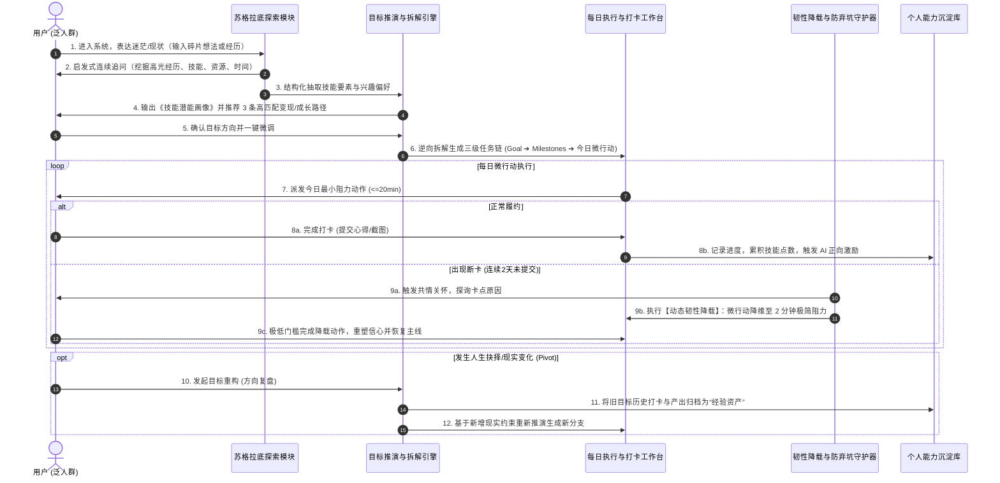
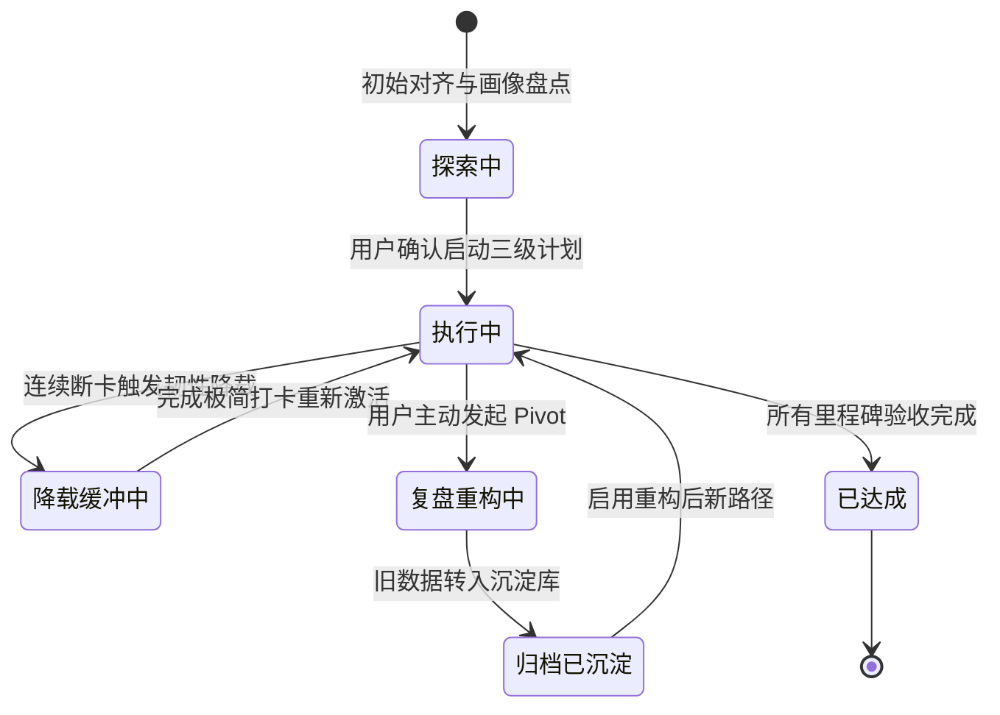
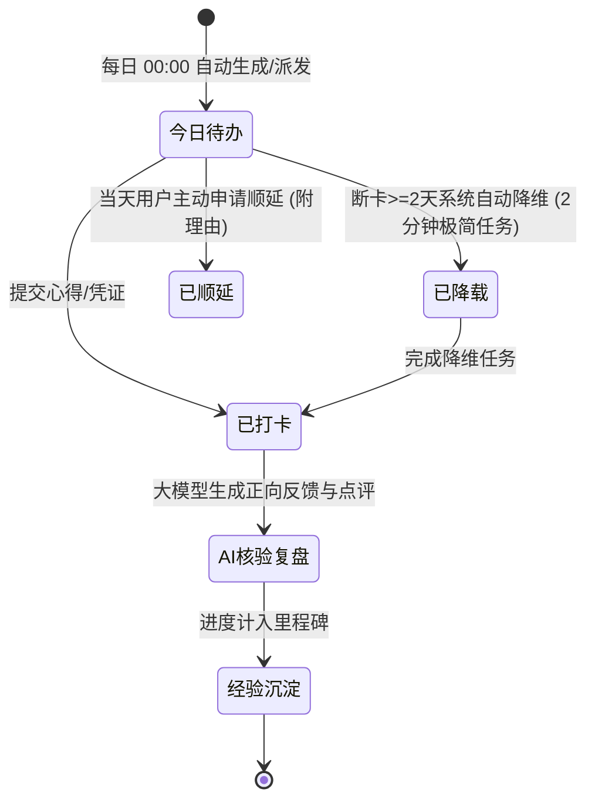
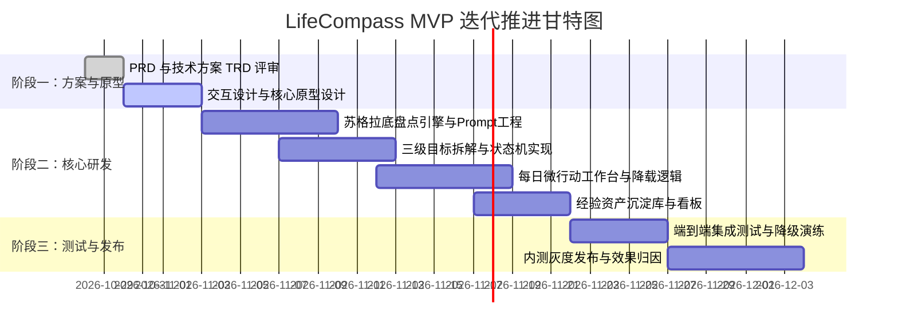

# 【产品需求文档】LifeCompass 人生罗盘：AI个人潜能盘点与人生目标导航系统 (PRD)

| 文档版本 | 文档状态 | 编写人 | 创建日期 | 评审日期 |
| :--- | :--- | :--- | :--- | :--- |
| V1.0.0 | Approved | PM 工作流助手 | 2026-10-28 | 2026-10-28 |

---

## 1. 需求背景与业务价值

### 1.1 业务背景与问题痛点
- **现状背景**：
  在当代快节奏、不确定性加剧的社会环境中，大量人群（涵盖在校大学生、职场新人、35岁转型期人员、自由职业者）深陷“迷茫与内耗”中。市场上充斥着大量传统的人生规划测评、打卡工具或纯鸡汤内容，但普遍存在“测评完就搁置”、“定了个宏大目标却不知从何做起”、“打卡几天断签后彻底弃坑”的恶性循环。
- **核心痛点**：
  1. **自我认知盲区（不知道自己拥有什么）**：缺乏系统化盘点自身经历、软硬技能与隐藏优势的能力，往往妄自菲薄或盲目跟风。
  2. **路径变现断层（不知道如何达成目标与变现）**：空有技能或兴趣，但不知道如何将技能转化为高杠杆商业变现价值或阶梯式职业突破路径；人生重大选择缺乏客观、结构化的决策推演工具。
  3. **知行合一瓦解（无法坚持做下去）**：目标定得过大、行动阻力过高，一旦断卡产生内疚感与习得性无助，导致全盘放弃。
  4. **沉没成本焦虑（一旦换方向感觉前功尽弃）**：现实环境变化或兴趣转移时，害怕沉没成本，不敢调整方向，或调整后历史数据清零导致信心崩溃。

### 1.2 业务目标与价值衡量 (Success Metrics)
- **核心目标**：
  打造一款**纯 AI 驱动的“个人认知资产盘点、变现路径智能推演、抗挫韧性监督执行”**的人生导航成长伴侣（LifeCompass）。通过低阻力的启发式对话帮用户摸清家底、立准目标、切细动作、兜底心力，让用户在小步快跑中逐步建立正反馈，达成知行合一。
- **北极星指标与衡量标准 (KPI / North Star Metric)**：
  - **北极星指标**：**30 天微行动持续激活率（30-Day Resilient Active Rate）** —— 衡量用户在经历偶发断卡与动态降载后，依然留在成长闭环中的比例（目标 $\ge 45\%$）。
  - **资产盘点完成率**：注册新用户在 15 分钟内通过苏格拉底式 AI 对话完成《个人技能与潜能数字画像》的比率 $\ge 70\%$。
  - **目标分解可执行度**：生成的首期里程碑拆解中，用户在 24 小时内完成首个“20分钟最小阻力微行动”打卡比例 $\ge 65\%$。
  - **韧性挽回转化率**：触发“动态韧性降载机制”后，用户在 48 小时内完成降维微动作打卡并恢复常态的挽回率 $\ge 50\%$。

---

## 2. 用户角色与画像

| 角色分类 | 代表人群 | 核心现状与诉求 | 行为特征与频次 | 系统核心交付形态 |
| :--- | :--- | :--- | :--- | :--- |
| **迷茫起步者** | 应届生 / 职场新人 (0~2年) | 缺乏行业清晰认知，不知道自己擅长什么，求职或起步方向不明确。 | 高频浏览，但容易受挫迷茫；每日需要明确指引。 | 苏格拉底式经历挖掘、职业技能树对齐、新手微动作打卡。 |
| **瓶颈突破者** | 职场中坚 / 转型期白领 (3~8年) | 有专业积累但遭遇天花板，渴望副业变现、转换赛道或提升单位时间价值。 | 碎片化时间，目标感较强但行动力被工作消耗，每周复盘需求强烈。 | 商业变现路径推演、技能价值杠杆重组、阶梯里程碑拆解。 |
| **自主探索者** | 自由职业者 / 泛人群 | 技能多而不精或时间自由度高，容易自律滑坡、拖延或缺乏结构化规划。 | 节奏波动大，容易间歇性发力与停滞。 | 动态韧性降载（防弃坑）、经验资产沉淀库、方向重构 (Pivot)。 |

---

## 3. 需求范围与边界界定

### 3.1 包含范围 (In-Scope / MVP)
1. **苏格拉底式认知盘点引擎 (Onboarding Exploration)**：基于大模型的启发式交互对话，多维度挖掘用户经历、隐性技能、兴趣与高光时刻，自动沉淀《个人技能与潜能数字画像》。
2. **目标智能生成与变现路径逆向拆解 (Goal & Monetization Engine)**：
   - 支持变现型目标、职业跃迁目标、个人成长目标三类模型；
   - 采用标准三级树状结构：宏观目标 (Goal) ➔ 阶段里程碑 (Milestone) ➔ 每日微行动 (Daily Action, 阻力 $\le 20$ 分钟)。
3. **抗挫韧性监督与每日打卡工作台 (Daily Execution & Resilient Supervisor)**：
   - 每日微行动多模态打卡（文字小结、截图凭证、反思心得）；
   - **动态韧性降载机制 (Anti-Drop)**：连续 2 天断卡或用户表达情绪受阻时，AI 主动介入共情关怀，将行动降维至“2分钟极简动作”，消解内疚与阻力。
4. **人生支线重构与经验资产沉淀 (Pivot Flow)**：
   - 支持用户主动发起“方向复盘”；
   - 调整目标时，历史已打卡天数与成果自动封存转入“个人能力沉淀库”，数据永久保留、经验可继承复用。
5. **智能成长看板与复盘周报 (Growth Dashboard & Retrospective)**：
   - 技能资产雷达图、目标推进燃尽图、韧性恢复指数、AI 周期性深度复盘报告。

### 3.2 不包含范围 (Out-of-Scope / Non-Goals)
> 严格锁定产品边界，杜绝重运营与非核心功能蔓延：
- ❌ **坚决不做真人导师咨询与预约服务**：100% 保持纯 AI 工具与智能伴侣形态，不引入真人服务、预约日历或客服撮合。
- ❌ **坚决不做 C2C 技能外包撮合接单市场**：避免沉重的双边供需运营、交易担保与售后纠纷。
- ❌ **坚决不做临床心理咨询与医疗干预**：产品明确定位于“个人成长效能与目标路径规划”，遇到严重心理危机时提供标准合规免责声明与公立援助热线引导。
- ❌ **坚决不做泛娱乐社交平台与公共信息流**：不设公共广场、排行榜竞争或社交动态墙，聚焦个人专注与私密成长。

---

## 4. 业务架构与全局流程

### 4.1 核心业务全链路 (User Journey & Architecture)

### 4.2 核心业务状态机流转 (State Diagrams)

#### 1) 宏观目标 (Goal) 状态机

#### 2) 每日微行动 (Daily Action) 状态机

---

## 5. 功能需求详细说明 (Feature Breakdown)

### 模块一：苏格拉底式认知盘点与画像生成 (Module Onboarding)

#### 功能点 F-01：AI 启发式深度对话盘点（优先级：P0）
1. **功能概述**：
   通过拟人化专业人生教练语气，以启发式多轮追问方式，分层挖掘用户的过往经历、技能长项、隐性资源与现实约束。
2. **前置条件**：
   用户首次进入或主动点击“重测个人资产”。
3. **交互动线**：
   - 界面呈现沉浸式对话卡片，AI 主动抛出引导式问题（如：“回顾过去3年，哪件事让你最有成就感，即使没有报酬也愿意投入？”）；
   - 提供快速选择气泡标签辅助输入，亦支持自由输入语音或文字；
   - 历经 4~6 轮聚焦问答后，自动触发总结提炼。
4. **业务处理逻辑与规则**：
   - **技能归纳算法**：从用户叙述中抽取三类标签：
     - 硬技能（如：视频剪辑、Python数据分析、财务报表等）；
     - 软技能/元能力（如：同理心倾听、跨部门协调、结构化逻辑表达等）；
     - 资源禀赋（如：每周可支配15小时、拥有垂直行业人脉等）。
   - **防假想校验**：AI 需检验“技能掌握真实度”，通过场景化微提问验证（例如：“你刚才提到擅长写作，平时更擅长故事类、干货类还是商业文案？”）。
5. **异常与分支情况**：
   - 用户回答“我什么都不会/我没有特长”时，AI 触发“暗光挖掘模板”，引导回顾生活中最小的积极经历（如“能把复杂琐事整理得井井有条也是一种出色的统筹能力”），保护用户自尊。

#### 功能点 F-02：《个人技能与潜能数字画像》报告生成（优先级：P0）
1. **功能概述**：
   盘点结束后，即时生成可视化多维能力资产卡片，包含能力雷达图、优势变现杠杆评估与核心约束矩阵。
2. **界面呈现**：
   - 顶部：核心优势标签云（如“逻辑解构”、“高情商沟通”）；
   - 中部：五维能力雷达图（专业硬核度、商业感知力、执行驱动力、学习敏捷度、抗挫韧性）；
   - 底部：3 个基于该画像反推的“最具变现潜力的人生发展赛道”。
3. **业务处理逻辑**：
   - 每一项能力均支持用户点击后进行手动校准（添加备注、微调级别）。

---

### 模块二：变现路径反推与目标三级拆解 (Module Goal & Monetization)

#### 功能点 F-03：目标逆向生成与路径推演（优先级：P0）
1. **功能概述**：
   基于用户选择的人生目标（例如“6个月内通过自媒体+小红书知识付费副业实现月入 5000 元”），由 AI 逆向倒推关键达成路径。
2. **业务规则**：
   - **三级结构标准约束**：
     - **Level 1 宏观目标 (Goal)**：明确的周期（3~12个月）与明确的定量/定性检验标准。
     - **Level 2 阶段里程碑 (Milestones)**：将总周期拆解为 3~4 个阶段（如：第1阶段-定位与MVP验证；第2阶段-内容矩阵搭建；第3阶段-商业闭环跑通）。
     - **Level 3 每日微行动 (Daily Action)**：单项任务耗时必须控制在 $\le 20$ 分钟内（如“今天仅撰写 3 条选题大纲”），坚决避免“写一篇3000字爆款”这类高阻力大任务。
3. **异常处理**：
   - 若用户自定义的目标过于抽象（如“我要暴富”、“成为成功人士”），系统拦截并提示：“请与 AI 重新细化，将目标量化或锚定具体场景”。

---

### 模块三：抗挫韧性监督与每日打卡工作台 (Module Execution & Resilience)

#### 功能点 F-04：每日微行动工作台与打卡提交（优先级：P0）
1. **功能概述**：
   每日为用户展示当日待办微行动卡片（默认 1~2 项，不超过 3 项），支持快速打卡与沉淀。
2. **交互说明**：
   - 卡片突出显示预计耗时（如：`预计 15 分钟`）、核心执行指引与参考模板；
   - 打卡支持上传 10~500 字反思心得、成果截图（图片）或直接勾选完成；
   - 提交后，AI 立即生成专属点评（肯定付出 + 指出细节闪光点 + 提示明日预期）。

#### 功能点 F-05：动态韧性降载机制 (Anti-Drop)（优先级：P0 核心亮点）
1. **功能概述**：
   攻克传统打卡产品“一断卡就弃坑”的痛点，用“降低阻力与心理接纳”替代“惩罚责备”。
2. **触发条件**：
   - 条件一：系统检测到用户连续 2 天（48小时）未进行微行动打卡；
   - 条件二：用户在对话中输入表达疲惫、拖延、压力大、做不下去等负向情绪。
3. **降载处理动作**：
   - **话术共情**：AI 弹出温和对话：“生活总有波澜，暂停并不代表失败。我们先给心力充会儿电。”坚决杜绝任何指责或催促字眼。
   - **任务自动降维**：将原定的 20 分钟微行动即刻替换为“2分钟极简动作”：
     - 示例 A（阅读/学习类）：从“学习课程1章节”降维至“打开文档阅读任意 1 段话”；
     - 示例 B（副业写作类）：从“输出文案初稿”降维至“写下一句话想法”；
     - 示例 C（运动类）：从“跑步3公里”降维至“换上运动鞋在房间站立1分钟”。
   - **完成即算打卡成功**：只要用户完成 2 分钟极简动作，系统同样判定打卡连续，发放“韧性勋章”，保住习惯火种。

---

### 模块四：人生支线重构与经验资产沉淀 (Module Pivot & Capital)

#### 功能点 F-06：目标重构与支线调整 (Pivot Flow)（优先级：P1）
1. **功能概述**：
   当用户遇到现实变故（如换工作、精力不足）或发现当前路径不适合自己时，支持无痛转向，不背负沉没成本。
2. **业务流程**：
   - 用户发起“方向复盘”；
   - AI 引导用户回答 2 个关键问题：“是什么促使你想要调整？”以及“过去这段时间的尝试中，你发现了什么？”；
   - 确认调整后，系统自动生成旧目标《阶段成长结项报告》，并将已沉淀的打卡记录、输出文档、探索心得永久封存至【经验资产沉淀库】；
   - 系统基于用户新的现实条件生成新目标三级方案，用户等级、累计成长值不归零。

#### 功能点 F-07：个人经验资产沉淀库 (Experience Asset Hub)（优先级：P1）
1. **功能概述**：
   集中展示用户在系统内积累的所有认知资产，包含：
   - 技能资产（已点亮的技能项与熟练度评估）；
   - 产出成果（所有打卡提交的笔记、思考片段、作品集链接）；
   - 韧性历程（克服了多少次停滞、完成了多少次降维重启）。

---

## 6. 非功能性需求 (NFR)

1. **响应性能**：
   - AI 盘点问答与打卡复盘生成的首字响应延迟 (TTFT) $\le 1.2$ 秒，全流式平滑输出。
   - 移动端页面核心内容首次绘制 (FCP) $\le 1.0$ 秒。
2. **数据安全与隐私合规**：
   - 用户个人经历、职业信息、日记反思等内容属于高敏感个人隐私，数据库必须落盘加密（AES-256）；
   - 大模型调用前统一实施 PII 脱敏（手机号、真实姓名、公司敏感标识脱敏处理）；
   - 明确隐私协议：用户个人成长数据绝不用作公共基础大模型训练。
3. **系统可用性**：
   - 服务 SLA 达到 $99.9\%$，多可用区容灾。
   - 大模型 API 异常或超时（>8s）时，具备优雅降级机制（展示本地启发式问卷或离线打卡待同步队列）。
4. **前端工程规约**：
   - 严格遵循仓库规则：全栈采用 **TypeScript** 开发；前端统一采用 **Vue 3 或 React (TSX)** 驱动，禁止原生裸 HTML 堆砌，支持离线/内网高可用。

---

## 7. 数据埋点与监控指标

| 序号 | 埋点事件标识 (Event Key) | 触发时机 | 核心上报参数 | 分析与监控目的 |
| :--- | :--- | :--- | :--- | :--- |
| M-01 | `onboarding_chat_start` | 用户首次进入盘点对话 | `user_id, source_channel` | 计算启动率与漏斗起点 |
| M-02 | `skill_profile_generated` | 《个人技能资产画像》成功生成 | `user_id, skill_tags_count, duration` | 盘点完播率与画像丰富度 |
| M-03 | `goal_plan_confirmed` | 用户确认并启动三级规划 | `user_id, goal_type, milestone_count` | 目标方案采纳率 |
| M-04 | `daily_action_completed` | 用户提交每日微行动打卡 | `user_id, action_id, is_reduced_load, cost_minutes` | 核心履约率与常规/降载占比 |
| M-05 | `resilience_guard_triggered` | 系统判定并触发动态韧性降载 | `user_id, continuous_idle_days, trigger_reason` | 预警用户流失风险 |
| M-06 | `resilience_recovered` | 用户在降载后完成 2 分钟极简打卡 | `user_id, recovery_hours` | 衡量抗挫降载挽回有效性 |
| M-07 | `goal_pivot_initiated` | 用户发起目标重构 (Pivot) | `user_id, old_goal_id, reason_category` | 分析路径调整动因与留存影响 |

---

## 8. 实施计划与里程碑

| 里程碑阶段 | 计划周期 | 核心交付物 | 质量与通过标准 |
| :--- | :--- | :--- | :--- |
| **M1: 方案锁定** | 2026-10-28 ~ 2026-10-29 | 完整 PRD 文档、TRD 架构设计及接口契约 | 产研评审全票通过 |
| **M2: 原型与Prompt设计** | 2026-10-30 ~ 2026-11-02 | Vue 3 / React 高保真原型、启发式盘点 Prompt 调优集 | 5 名目标用户体验测试无认知障碍 |
| **M3: 核心功能编码** | 2026-11-03 ~ 2026-11-21 | 认知盘点、三级目标、动态降载与资产库完整前后端工程 (TS) | 单元测试通过率 100%，无阻塞性 Bug |
| **M4: 验收与灰度** | 2026-11-22 ~ 2026-12-04 | 自动化测试报告、灰度监控看板、首期种子用户上线 | 7 日微行动留存率 $\ge 60\%$ |

---

## 9. 风险识别与应对预案

| 风险类别 | 风险描述 | 影响等级 | 应对与缓解策略 |
| :--- | :--- | :--- | :--- |
| **体验风险** | 大模型幻觉生成不切实际的“变现途径”（如不切实际的收入承诺） | **高** | 建立严密的 Prompt 约束与内置现实性校验规则库；变现路径必须基于可验证的阶梯式微尝试（如“先拿到第一个10元付费用户”），禁止做出任何绝对化收益保障承诺。 |
| **心理风险** | 用户产生严重自责情绪或沉迷于“完美打卡”导致的心理压力 | **中** | 强化产品共情机制与心理暗示，将“断卡”重新定义为“身心需要休整的生理信号”，全方位推广 2 分钟极简行动文化。 |
| **技术风险** | 大模型厂商服务波动导致盘点或复盘请求超时 | **中** | 采用双大模型主备切换策略；打卡工作台支持离线本地缓存，打卡凭证先行存入本地 IndexedDB，网络恢复后后台异步同步。 |
