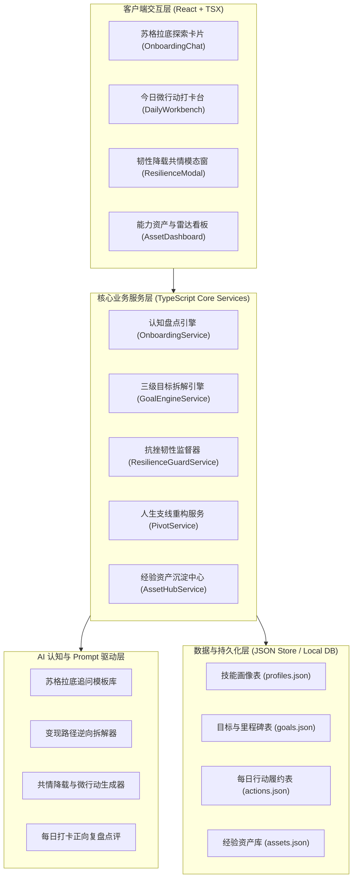
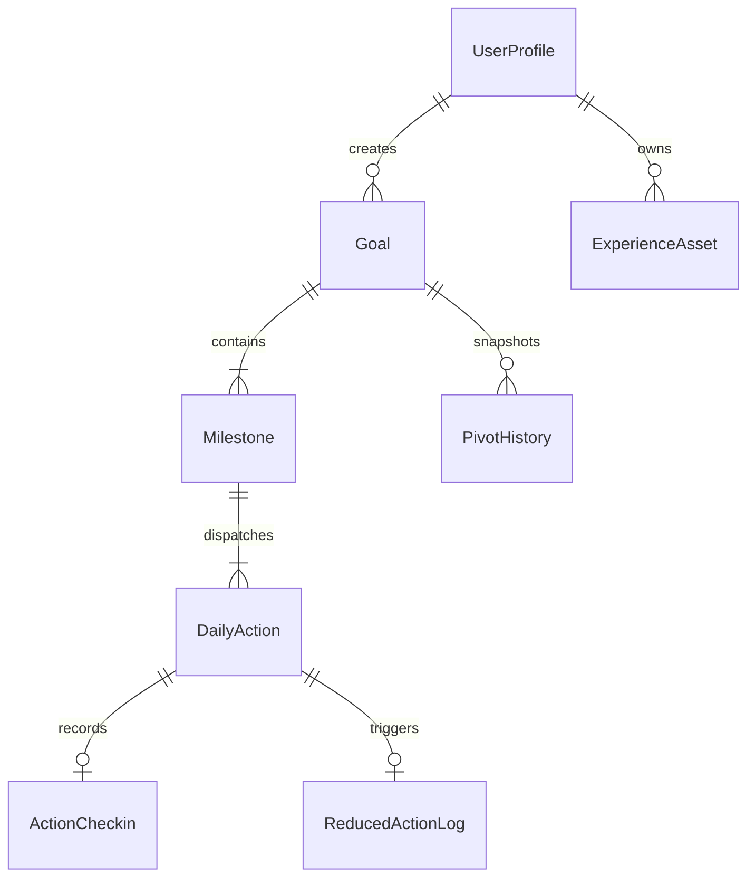
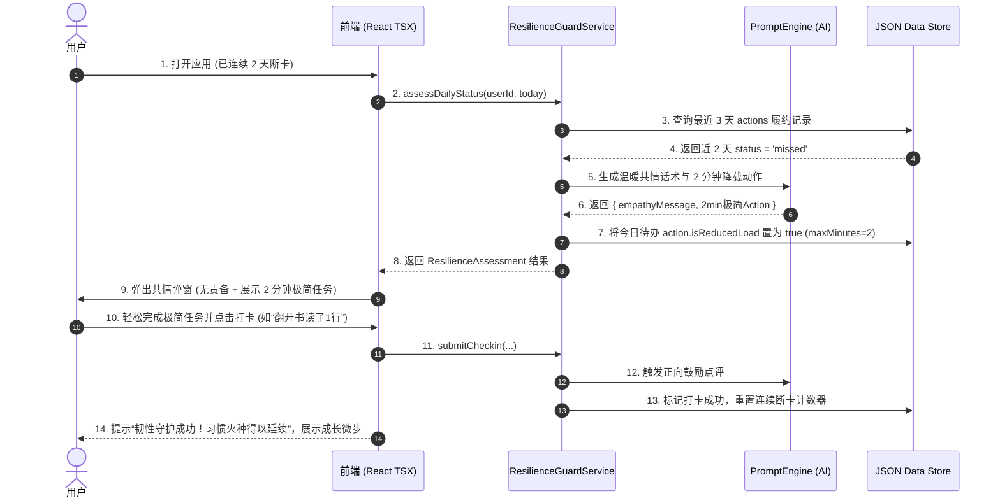

# 【技术方案设计】LifeCompass 人生罗盘：系统架构与核心引擎方案 (TRD)

| 文档版本 | 文档状态 | 编写人 | 评审日期 | 关联 PRD |
| :--- | :--- | :--- | :--- | :--- |
| V1.0.0 | Approved | 架构设计组 | 2026-10-28 | [PRD-LifeCompass.md](../prd/PRD-LifeCompass.md) |

---

## 1. 架构总览与设计目标

### 1.1 系统上下文与目标
- **业务承载**：
  承接 PRD-LifeCompass 所定义的个人认知资产盘点、变现路径逆向拆解、动态韧性监督（防弃坑）、以及目标重构 (Pivot) 的完整业务闭环。
- **技术目标**：
  - **100% TypeScript 规约**：全栈、CLI、脚本及前端组件严格强制采用 TypeScript，禁止 `.js` 文件。
  - **现代前端状态驱动**：用户交互界面统一采用 React (`.tsx`) 组件化驱动，严禁裸原生 HTML/DOM 操控；支持离线单包运行与局域网高可用。
  - **轻量开箱即用与内网免依赖**：基于 Node.js 22.6+ 原生 TS / ESM 与内置测试运行器 (`node --test`)，无冗余重型外部依赖。
  - **高韧性与即时响应**：AI 探索与打卡复盘响应延迟 TTFT $\le 1.2$ 秒；离线数据本地先行缓存（Local Store / JSON Engine），支持断网打卡与后台自动重试同步。

### 1.2 架构全景图 (Architecture Overview)



---

## 2. 领域模型与数据架构 (Data Schema)

### 2.1 实体关系图 (ER Diagram)



### 2.2 数据模型定义与存储结构

数据存储采用结构化轻量级文件持久化引擎（JSON Schema 规范），支持并发事务安全写入与版本控制。

---

## 3. 核心接口与协议规范 (TypeScript Contract)

> **全局强制 TypeScript 规范**：所有实体、输入入参、返回值均采用严谨的 TypeScript Interface / Type 声明。

### 3.1 核心数据结构与契约代码 (`src/types/index.ts`)

```typescript
/**
 * 技能类别枚举
 */
export type SkillCategory = 'hard' | 'soft' | 'resource';

/**
 * 技能与潜能标签
 */
export interface SkillTag {
  id: string;
  name: string;
  category: SkillCategory;
  proficiencyLevel: 1 | 2 | 3 | 4 | 5; // 1: 了解, 3: 熟练, 5: 精通/高杠杆
  evidence: string; // 提取来源证据（如项目经历或高光事件）
  monetizationScore: number; // 商业变现潜力打分 1~100
}

/**
 * 用户技能潜能画像
 */
export interface UserSkillProfile {
  userId: string;
  createdAt: string;
  updatedAt: string;
  summary: string; // 一句话定位
  skills: SkillTag[];
  constraints: {
    weeklyAvailableHours: number;
    riskTolerance: 'conservative' | 'balanced' | 'aggressive';
    currentDomain: string;
  };
  recommendedTracks: {
    trackName: string;
    rationale: string;
    estimatedValue: string;
    matchScore: number;
  }[];
}

/**
 * 目标类型与状态
 */
export type GoalType = 'monetization' | 'career_advance' | 'skill_mastery';
export type GoalStatus = 'exploring' | 'active' | 'reduced_load' | 'pivoting' | 'archived' | 'completed';

/**
 * 宏观目标 (Level 1)
 */
export interface Goal {
  id: string;
  userId: string;
  title: string;
  type: GoalType;
  status: GoalStatus;
  targetMetric: string; // 检验标准，例如：“小红书粉丝破千且获得首单变现 500元”
  estimatedMonths: number;
  startDate: string;
  targetEndDate: string;
  milestones: Milestone[];
  createdAt: string;
  updatedAt: string;
}

/**
 * 阶段里程碑 (Level 2)
 */
export type MilestoneStatus = 'pending' | 'in_progress' | 'achieved' | 'pivoted';

export interface Milestone {
  id: string;
  goalId: string;
  sequence: number; // 1, 2, 3...
  title: string;
  keyDeliverable: string; // 核心交付物，例如：“完成首批10篇笔记发布并跑通选题模板”
  status: MilestoneStatus;
  estimatedWeeks: number;
  dailyActions: DailyAction[];
}

/**
 * 每日微行动 (Level 3 - 核心履约单元)
 */
export type ActionStatus = 'pending' | 'completed' | 'reduced' | 'postponed' | 'missed';

export interface DailyAction {
  id: string;
  milestoneId: string;
  title: string;
  instruction: string;
  maxMinutes: number; // 阻力限制，常规 <= 20 分钟；降载 <= 2 分钟
  isReducedLoad: boolean; // 是否处于 2 分钟动态降载状态
  status: ActionStatus;
  scheduledDate: string; // YYYY-MM-DD
  checkin?: ActionCheckin;
}

/**
 * 打卡履约记录
 */
export interface ActionCheckin {
  checkinTime: string;
  summary: string; // 用户心得/产出反思
  attachmentUrl?: string; // 成果凭据（截图/作品链接）
  actualMinutes: number;
  aiFeedback: {
    encouragement: string; // 共情肯定
    highlight: string; // 闪光点提炼
    nextStepTip: string; // 极简提示
  };
}

/**
 * 动态韧性守护器判定结果
 */
export interface ResilienceAssessment {
  consecutiveMissedDays: number;
  shouldDowngrade: boolean; // 是否需要触发动态降载
  empathyMessage: string; // 温暖共情文案
  reducedAction?: {
    title: string;
    instruction: string;
    maxMinutes: 2; // 降载为极简 2 分钟
  };
}

/**
 * 支线重构 (Pivot) 请求与沉淀模型
 */
export interface GoalPivotRequest {
  goalId: string;
  reason: string; // 转向诱因
  lessonLearned: string; // 踩坑与发现
  newDirection: string; // 新探索方向
}

export interface ExperienceAsset {
  id: string;
  userId: string;
  sourceGoalId: string;
  title: string;
  acquiredSkills: string[];
  totalCheckins: number;
  keyOutputs: string[]; // 产出的文档/笔记摘要
  archivedAt: string;
}
```

### 3.2 核心服务接口契约定义

```typescript
/**
 * 1. 认知盘点引擎接口
 */
export interface IOnboardingService {
  startSession(userId: string): Promise<{ sessionId: string; firstQuestion: string }>;
  respondAndContinue(sessionId: string, userReply: string): Promise<{
    isFinished: boolean;
    nextQuestion?: string;
    profile?: UserSkillProfile;
  }>;
}

/**
 * 2. 目标拆解引擎接口
 */
export interface IGoalEngineService {
  createGoalFromTrack(userId: string, trackName: string, customDetails?: string): Promise<Goal>;
  getGoalById(goalId: string): Promise<Goal | null>;
  listGoals(userId: string): Promise<Goal[]>;
}

/**
 * 3. 动态韧性监督守护器接口 (Anti-Drop)
 */
export interface IResilienceGuardService {
  assessDailyStatus(userId: string, date: string): Promise<ResilienceAssessment>;
  applyReducedLoad(actionId: string): Promise<DailyAction>;
  submitCheckin(actionId: string, summary: string, actualMinutes: number, attachmentUrl?: string): Promise<ActionCheckin>;
}

/**
 * 4. 支线重构与经验沉淀服务接口 (Pivot & Asset)
 */
export interface IPivotService {
  pivotGoal(request: GoalPivotRequest): Promise<{
    archivedAsset: ExperienceAsset;
    newGoal: Goal;
  }>;
  listAssets(userId: string): Promise<ExperienceAsset[]>;
}
```

---

## 4. 关键技术方案与算法逻辑

### 4.1 核心时序：从断卡到动态韧性降载 (Anti-Drop Sequence)



### 4.2 启发式多维提问与画像抽取算法 (Socratic Heuristics)
1. **状态驱动的四阶提问流**：
   - 阶段 1 (高光反思)：挖掘过去最引以为傲或废寝忘食的经历 ➔ 抽取初始技能标签。
   - 阶段 2 (现实资源与时间)：盘点每周可支配时间与当前主业约束 ➔ 建立边界限制。
   - 阶段 3 (商业敏锐度)：探查是否有过任何被咨询、帮忙甚至收取报酬的萌芽经历 ➔ 计算变现潜力。
   - 阶段 4 (综合收敛)：综合生成画像，推荐 3 条高杠杆变现路径（如：自媒体垂直博主、咨询微服务、模板资源包出售）。
2. **防假想校验规则**：
   若提取到的技能缺乏实际行为证据（Evidence 为空），系统将插入追问：“你曾在哪次具体场景下运用过它？当时的结果如何？”以确保证据驱动。

### 4.3 动态韧性降载算法 (Anti-Drop Algorithm)
```typescript
export function evaluateResilience(consecutiveMissedDays: number, currentAction: DailyAction): ResilienceAssessment {
  if (consecutiveMissedDays >= 2 || currentAction.isReducedLoad) {
    return {
      consecutiveMissedDays,
      shouldDowngrade: true,
      empathyMessage: '生活偶尔会打乱节奏，暂时的停顿是蓄力而非失败。今天不要求长途跋涉，我们只花 2 分钟点亮火种。',
      reducedAction: {
        title: `【2分钟降载微步】${downgradeTitle(currentAction.title)}`,
        instruction: '无需追求完美，只需完成第一步极简动作即可打卡。',
        maxMinutes: 2
      }
    };
  }
  return {
    consecutiveMissedDays,
    shouldDowngrade: false,
    empathyMessage: '新的一天，继续向着目标稳步推进！'
  };
}

function downgradeTitle(originalTitle: string): string {
  if (originalTitle.includes('写') || originalTitle.includes('文案')) return '在备忘录写下一句话灵感';
  if (originalTitle.includes('读') || originalTitle.includes('学')) return '翻开第一页浏览前两行';
  if (originalTitle.includes('整理') || originalTitle.includes('调研')) return '搜集并保存 1 个参考链接';
  return '用 2 分钟做最轻松的启动动作';
}
```

### 4.4 现代前端组件架构设计 (React + TSX)
- 遵循全局规约：Web 交互控制台与移动端视图采用 **React 18 + TypeScript (TSX)** 纯组件化方案，包含以下核心组件：
  1. `<OnboardingChat />`：具有打字机动效的启发式问答流，气泡标签一键选择；
  2. `<DailyWorkbench />`：今日待办卡片、预计用时倒计时、多模态打卡表单；
  3. `<ResilienceModal />`：触发断卡降载时的共情模态对话框，支持一键接受 2 分钟极简微步；
  4. `<AssetRadarDashboard />`：能力资产五维雷达图与经验资产归档卡片。

---

## 5. 异常处理与容灾降级 (Fault Tolerance)

| 故障场景 | 检测方式 | 恢复/降级策略 |
| :--- | :--- | :--- |
| **AI 模型接口超时/中断** | 请求耗时超过 5 秒或抛出网络异常 | 自动降级为内置专家启发式提问模板库与内置规则，不阻塞用户继续操作。 |
| **断网/内网弱网环境** | `navigator.onLine === false` 或 fetch 失败 | 触发前端离线保护模式，打卡记录暂存本地 IndexedDB/LocalCache，待联网后后台自动重试上报。 |
| **并发数据写入冲突** | 数据版本号 (Version) 不一致 | 采用乐观锁，读取最新状态后合并补丁重新写入，保障数据不丢失。 |
| **极端连断放弃** | 连续 7 天未打卡且降载亦无回应 | 暂停每日推送打卡，发送静默休眠关怀卡片，待用户主动进入时触发“重启人生新支线”。 |

---

## 6. 部署架构与依赖环境

- **运行时环境**：Node.js 22.6+ / 24+ 原生 ESM 与 TypeScript 支持。
- **构建与测试工具**：
  - 测试命令：`npm test` ➔ `node --test tests/*.test.ts` 原生执行。
  - 前端支持：React / TSX 纯组件驱动，支持独立内网构建与零外部 CDN 强依赖。
- **存储方案**：本地轻量级文件持久化引擎 (`data/*.json`)，免去复杂外部数据库配置，开箱即用。
