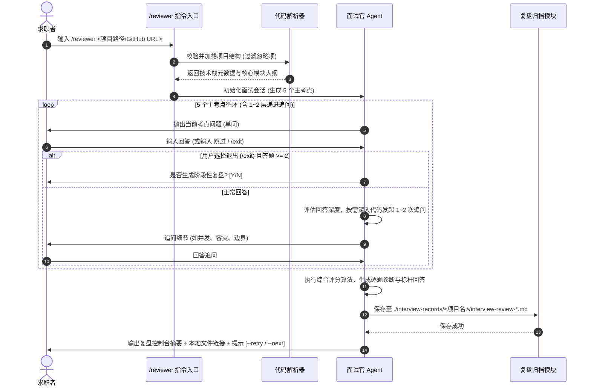

# 【产品需求文档】ProjectReviewer - 代码驱动型智能模拟面试官 (PRD)

| 文档版本 | 文档状态 | 编写人 | 创建日期 | 评审日期 |
| :--- | :--- | :--- | :--- | :--- |
| V1.0.0 | Approved | Antigravity PM Superpower | 2026-11-03 | 2026-11-03 |

---

## 1. 需求背景与业务价值

### 1.1 业务背景与问题痛点
- **现状背景**：技术岗位求职竞争日益激烈，面试官往往不会仅停留在通用八股文，而是围绕候选人简历中的实际项目代码、架构设计和核心难点进行层层深挖。
- **核心痛点**：
  1. **练习脱离实战**：求职者自学通常只能背诵八股或刷 LeetCode，缺乏针对自己实际写过的工程项目进行真实面试场景的对练。
  2. **盲区难自知**：求职者难以提前预判面试官会从哪些代码细节、设计漏洞或并发瓶颈发起攻击，导致面试时被突击问懵。
  3. **缺乏标杆复盘**：传统模拟面试要么成本高昂（如付费大厂模拟面），要么缺乏结构化沉淀，求职者答完后不知道自己的回答在大厂面试官眼中值多少分、缺失了哪些关键要点、标杆回答应该如何组织。

### 1.2 业务目标与价值衡量 (Success Metrics)
- **核心目标**：构建一个基于本地工程或 GitHub 公开仓库的交互式模拟面试 Agent（`/reviewer`）。能够自动化提取代码特征，化身为专业、严苛的技术面试官，以“一来一回”的自适应追问机制进行实战对练，并在考后提供结构化深度复盘与标杆范例。
- **衡量指标 (KPI / North Star Metric)**：
  - **单轮模拟面试完整交付率**：$\ge 80\%$ 的用户能完整作答 5 个考点并生成复盘文档。
  - **复盘实用度评分**：复盘文档中“大厂高分标杆回答”和“改进方向”对求职者的帮助认可度达 $90\%$ 以上。
  - **面试通过率提升体感**：帮助求职者在正式面试前覆盖项目 $80\%$ 以上的潜在深挖盲区。

---

## 2. 用户角色与画像

| 角色名称 | 核心职责/定位 | 使用频次 | 核心诉求 | 关键权限 |
| :--- | :--- | :--- | :--- | :--- |
| **技术求职者** (核心用户) | 准备技术面试的工程师/架构师 | 高频 (求职冲刺期每天 1~3 轮) | 针对自己实际项目进行深度押题与模拟问答，获取大厂级别标杆回答与失分诊断 | 执行 `/reviewer`、作答、查看复盘、开启重练 |
| **模拟面试官 Agent** (智能体) | 严肃专业的技术考察者 | 自动化触发 | 快速抓取代码特征，提出尖锐且切中要害的技术问题，客观量化打分 | 代码解析、递进追问、报告沉淀与生成 |

---

## 3. 需求范围与边界界定

### 3.1 包含范围 (In-Scope / MVP)
- [x] **指令调用与输入解析**：支持 `/reviewer <本地项目绝对/相对路径 | GitHub公开仓库URL>` 唤起。
- [x] **轻重结合代码透视**：首轮快速解析工程骨架与元数据提炼 5 个核心考点；在问答推进中按需深入具体关键源码文件进行代码级深挖。
- [x] **面试官风格切换**：支持“技术深度与工程权衡型（架构师）”与“全面考察型（项目+八股+场景）”两种模式。
- [x] **单步自适应递进追问 (Turn-by-turn)**：严格遵循一来一回单问单答机制，禁止一次抛出多个问题；每个主考点视回答深度自适应进行 1~2 层深度追问（Follow-up）。
- [x] **跳过与异常应答兼容**：求职者回答“跳过/不了解/换一题”时，记为未掌握并平滑推进下一题。
- [x] **会话控制与中途退出**：支持 `/exit` 或 `/quit` 优雅终止。作答 $\ge 2$ 题时可询问是否提前生成阶段性复盘报告。
- [x] **工业级复盘文档输出**：包含综合评分（百分制）、雷达维度、逐题亮点/失分诊断、**大厂高分标杆范例回答 (Best Practice)** 及优化建议。
- [x] **独立文件归档沉淀**：复盘文档不仅在控制台打印摘要，同时自动保存至统一的 `./interview-records/<项目名>/` 目录下（标注被测项目名与时间戳）。
- [x] **多轮循环闭环**：考后支持 `--retry`（针对本轮弱项原题重练）与 `--next`（开启新考点全新面试）。

### 3.2 不包含范围 (Out-of-Scope / Non-Goals)
- ❌ **暂不支持 GitHub 私有仓库 (Private)**：MVP 仅支持本地路径与无需 Token 的 GitHub Public 仓库。
- ❌ **暂不支持语音实时流式对练**：MVP 聚焦纯文本 Markdown 对话，保证提问与回答的逻辑严密性与深度。
- ❌ **暂不支持重型外部数据库持久化**：会话状态保存在内存与当前执行上下文，历史沉淀完全基于结构化 Markdown 文件。

---

## 4. 业务架构与全局流程

### 4.1 核心业务主流程 (Sequence Diagram)

### 4.2 核心业务状态机流转 (State Diagram)

```mermaid
stateDiagram-v2
    [*] --> 闲置就绪 (Idle)
    闲置就绪 (Idle) --> 项目解析中 (Parsing): 收到 /reviewer <路径>
    项目解析中 (Parsing) --> 考点生成中 (Generating_Agenda): 代码结构校验通过
    项目解析中 (Parsing) --> 报错退出 (Error): 路径不存在/空项目/拉取超时
    
    考点生成中 (Generating_Agenda) --> 主题提问 (Asking_Main): 规划好 5 个考点
    主题提问 (Asking_Main) --> 等待作答 (Awaiting_Answer): 面试官输出问题
    
    等待作答 (Awaiting_Answer) --> 深度追问 (Follow_Up): 回答触发关键设计点 (最多2次)
    深度追问 (Follow_Up) --> 等待作答 (Awaiting_Answer): 抛出深入细节问题
    
    等待作答 (Awaiting_Answer) --> 推进下一题 (Next_Topic): 追问结束 / 候选人跳过
    推进下一题 (Next_Topic) --> 主题提问 (Asking_Main): 未满 5 题
    
    推进下一题 (Next_Topic) --> 复盘生成 (Generating_Review): 已完成全部考点
    等待作答 (Awaiting_Answer) --> 提前结算 (Early_Exit): 输入 /exit 且确认生成
    
    提前结算 (Early_Exit) --> 复盘生成 (Generating_Review)
    复盘生成 (Generating_Review) --> 完成归档 (Finished): 写入 Markdown 并展示
    
    完成归档 (Finished) --> 深度追问 (Follow_Up): 用户输入 --retry (重练)
    完成归档 (Finished) --> 考点生成中 (Generating_Agenda): 用户输入 --next (换题)
    完成归档 (Finished) --> [*]: 会话关闭
```

---

## 5. 功能需求详细说明 (Feature Breakdown)

### 模块一：项目代码接入与特征感知 (Ingestion & Parsing)

#### 功能点 F-01：多源项目接入与安全门控（优先级：P0）
1. **功能概述**：
   - 接收用户输入的本地目录路径或 GitHub 公开仓库 URL。
2. **前置条件与参数**：
   - 指令语法：`/reviewer <path-or-url> [--mode architect|comprehensive]`。
3. **输入校验与安全边界**：
   - **本地路径**：检查路径是否存在且可读；校验是否包含工程标识文件（如 `package.json`, `go.mod`, `pom.xml`, `Cargo.toml`, `requirements.txt`, `README.md` 等）。若为空目录或无代码，直接报错提示：“未在该目录下检测到有效代码工程，请核对路径”。
   - **GitHub 仓库**：限制拉取大小（上限 50MB）；自动过滤 `.git/`、`node_modules/`、`vendor/`、`dist/`、`build/` 及常见音视频/压缩包等大二进制文件。
4. **解析策略**：
   - **阶段一（启动期）**：轻量级提取项目名称、语言版本、核心第三方库、项目 README 与目录骨架，归纳出业务核心模块。
   - **阶段二（问答期）**：面试过程中，根据候选人聊到的具体服务或模块，动态定向读取关键源码，精准引用实际代码中的函数或类名向候选人提问。

---

### 模块二：模拟面试交互驱动引擎 (Interview Engine)

#### 功能点 F-02：单步自适应提问与追问机制（优先级：P0）
1. **交互原则**：
   - **绝对的一来一回**：每次仅输出 1 个问题，禁止输出“问题1、问题2、问题3”的多重轰炸。
   - **自适应深度追问**：
     - 单轮面试设定 5 个核心主考点（覆盖：架构设计、核心逻辑、并发/性能、边界异常、工程规范）。
     - 候选人回答后，若暴露技术盲区或提及关键技术名词，面试官紧随其后追问 1~2 层（如“*你在处理订单超时时用了 Redis 延迟队列，如果 Redis 宕机或者消息丢失怎么防范？*”）。
2. **特殊输入处理**：
   - **跳过/弃权**：候选人输入“跳过”、“不会”、“没了解过”时，面试官记录失分，给予一句话点拨并优雅切换至下一个主考点。
   - **偏离主题**：候选人回答泛泛而谈或答非所问时，面试官进行纠偏：“请紧扣该模块的代码实现和方案设计进行说明”。

#### 功能点 F-03：面试中断控制与提前结算（优先级：P1）
1. **指令规则**：
   - 候选人可随时输入 `/exit` 或 `/quit` 终止当前面试。
2. **处理逻辑**：
   - 若当前已作答题目 $< 2$ 题：直接终止会话，提示：“面试已取消，未达生成复盘报告的最小题目量”。
   - 若当前已作答题目 $\ge 2$ 题：提示：“您已完成部分面试考点，是否基于当前作答生成阶段性复盘报告？[Y/N]”。用户输入 Y 则执行即时结算输出，输入 N 则直接退出。

---

### 模块三：多维评分模型与复盘归档 (Review & Storage)

#### 功能点 F-04：百分制综合评分模型（优先级：P0）
1. **评分权重与考核维度**：
   - **技术深度与底层原理 (40%)**：考察语言特性、运行时机制、数据结构及依赖库的底层运作。
   - **架构设计与方案权衡 (30%)**：考察技术选型的 Trade-off、模块解耦、扩展性与技术前瞻性。
   - **工程边界与容灾防范意识 (20%)**：考察高并发、缓存击穿、幂等性、弱网降级与异常处理。
   - **表达逻辑与沟通表达 (10%)**：考察回答是否符合 STAR 原则（情境-任务-行动-结果）、逻辑是否结构化。
2. **评级等级**：
   - **S 级（$\ge 90$ 分）**：极力推荐 / 架构师/专家级表现。
   - **A 级（$80 \sim 89$ 分）**：通过 / 具备扎实的项目实战与解决问题能力。
   - **B 级（$70 \sim 79$ 分）**：犹豫待定 / 有项目经验但在底层或容灾上有明显短板。
   - **C 级（$< 70$ 分）**：未通过 / 缺乏项目掌控力或核心设计存在重大漏洞。

#### 功能点 F-05：工业级复盘文档与集中归档（优先级：P0）
1. **落盘位置规范**：
   - **集中归档于当前工具项目目录下**：`./interview-records/<被面试项目名>/interview-review-YYYYMMDD_HHmmss.md`。
   - 保证求职者在当前工作区即可全局总览多次、不同项目的面试记录。
2. **复盘文档必须包含的核心章节**：
   - **Part 1：面试概览与综合战力雷达**（总分、评级、四维得分明细）。
   - **Part 2：逐题深度复盘表 (逐题剖析)**：
     - 原面试提问（含追问链路）。
     - 候选人作答记录摘要。
     - 亮点与失分点透视（哪里答对了，哪里暴露了致命漏洞）。
     - **【核心价值】大厂标准高分范例参考回答 (Best Practice Reference Answer)**：给出资深架构师标准回答模板。
     - 针对性提升改进建议。
   - **Part 3：简历与项目阐述提分指南**：教候选人如何修改简历中的该项目描述话术，以及如何在真实面试中掌握主导权。

---

### 模块四：多轮循环与进阶演练 (Multi-round Loop)

#### 功能点 F-06：循环面试流转交互（优先级：P1）
1. **流转触发**：
   - 复盘展示完毕后，在文末提供后续操作快捷入口：
     - 输入 `/reviewer --retry`：锁定本轮扣分最多的弱项考点，以新的角度或追问重新挑战。
     - 输入 `/reviewer --next`：重新提取项目其他未考模块，生成全新 5 道主考题。

---

## 6. 非功能性需求 (NFR)

1. **响应体验**：
   - 首次分析代码并给出第 1 题的启动时间不超过 8 秒。
   - 候选人提交回答后，面试官生成追问或下一题的等待时间控制在 3 秒以内。
2. **稳定性与容错**：
   - 遇到网络波动、文件编码异常、代码解析异常时，系统应具备自愈能力，自动降级为通用架构考点，保障面试不崩断。
3. **隔离与隐私**：
   - 严格遵循只读原则，严禁在解析代码时向求职者的被测代码库写入任何临时文件。所有的复盘输出严格集中在 `./interview-records/`。

---

## 7. 实施计划与里程碑

| 阶段 | 周期 | 核心交付物 | 负责人 |
| :--- | :--- | :--- | :--- |
| **Phase 1: PRD 对齐与发布** | 当前 | 确定 3 轮问答共识，生成标准 PRD | PM / 用户 |
| **Phase 2: TRD 架构设计与接口契约** | 下一步 | 输出 `TRD-ProjectReviewer.md`，定义 TypeScript 类型与状态机契约 | 架构师 / 研发 |
| **Phase 3: 微任务拆解 (Tasks)** | 下一步 | 产出 `tasks-ProjectReviewer.md`（按 2~5 分钟粒度分解） | 研发团队 |
| **Phase 4: TDD 编码实现与自测** | 实施阶段 | 遵循 TypeScript 规约，红-绿-重构闭环，0 失败测试通过 | 研发团队 |
| **Phase 5: 真实项目演练与交付** | 验收阶段 | 使用真实开源/本地项目完成完整模拟面试验证 | 用户 / PM |

---

## 8. 风险识别与备选方案

| 潜在风险项 | 影响级别 | 应对与缓解策略 |
| :--- | :--- | :--- |
| **GitHub 访问超时或网络不稳定** | 高 | 增加拉取超时重试与清晰的友好提示，并优先建议用户使用本地项目路径进行面试 |
| **项目规模过大导致 Token 爆炸** | 中 | 采用两阶段轻重结合策略，先读结构大纲，仅在问答深挖时按需读取特定文件片段，严格限制单次上下文长度 |
| **求职者回答过短或消极应答** | 低 | 设定最低有效字数引导，提示用户展开说明思路，答不出则平滑切题不卡顿 |
