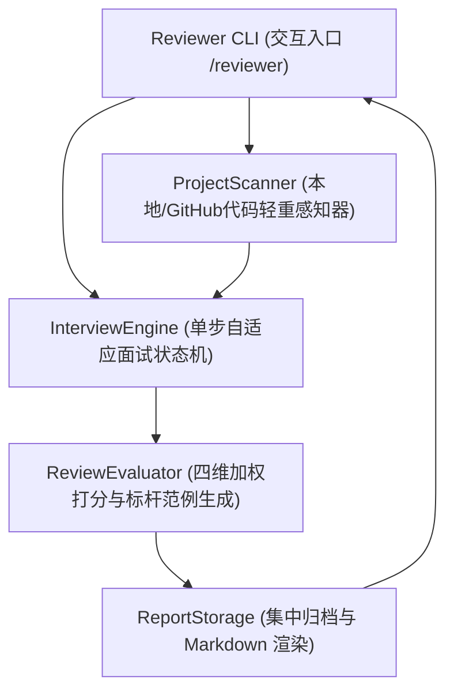

# 【技术方案设计】ProjectReviewer - 代码驱动型智能模拟面试官 (TRD)

| 文档版本 | 文档状态 | 编写人 | 评审日期 | 关联 PRD |
| :--- | :--- | :--- | :--- | :--- |
| V1.0.0 | Approved | Antigravity Dev Superpower | 2026-11-03 | [PRD-ProjectReviewer.md](../prd/PRD-ProjectReviewer.md) |

---

## 1. 架构总览与设计目标

### 1.1 系统上下文与目标
- **业务诉求**：为求职者提供基于本地工程或 GitHub 公开仓库代码特征的沉浸式模拟面试。系统作为面试官，严格以单步（一来一回）方式自适应追问 5 个核心技术考点，并在结束后生成具备大厂标杆范例的结构化复盘文档。
- **技术目标**：
  1. **零外部网络重量级依赖 (Zero-Bloat)**：基于 Node.js 24 原生 TypeScript 运行时与原生测试套件 (`node --test`)，开箱即用。
  2. **两阶段低开销代码解析**：首阶段仅读取元数据与架构骨架（秒级），提问中按需轻量索引代码片段，防止 Token 爆炸与内存飙升。
  3. **严格的单步自适应状态机**：维护 `IDLE -> ANALYZING -> ASKING_MAIN -> FOLLOW_UP -> GENERATING_REVIEW -> FINISHED`，支持求职者跳过、中途优雅结算 (`/exit`) 与多轮循环重练 (`--retry` / `--next`)。
  4. **只读安全性**：对候选人被测工程只读，所有复盘输出统一集中隔离在工具工程的 `./interview-records/<项目名>/` 目录下。

### 1.2 架构全景图 (Architecture Overview)



---

## 2. 领域模型与数据架构 (Domain Models & TypeScript Contracts)

> **全局强制 TypeScript 规约**：核心实体、状态机枚举与接口签名全部使用 TypeScript 严格强类型定义。

```typescript
// projects/ProjectReviewer/src/types/index.ts

/** 面试官风格模式 */
export type InterviewerMode = 'architect' | 'comprehensive';

/** 面试会话状态 */
export type SessionState = 
  | 'IDLE' 
  | 'ANALYZING' 
  | 'ASKING_MAIN' 
  | 'FOLLOW_UP' 
  | 'AWAITING_ANSWER' 
  | 'GENERATING_REVIEW' 
  | 'FINISHED' 
  | 'TERMINATED';

/** 项目技术栈与元数据 */
export interface ProjectMetadata {
  projectName: string;
  sourceType: 'local' | 'github';
  sourcePath: string;
  languages: string[];
  frameworks: string[];
  dependencies: Record<string, string>;
  fileCount: number;
  keyFiles: string[];
  summary: string;
}

/** 单个主考点定义 */
export interface TopicAgenda {
  id: string; // T1 ~ T5
  category: 'architecture' | 'core_logic' | 'concurrency_perf' | 'edge_cases' | 'engineering';
  title: string;
  targetFile?: string;
  codeSnippetRef?: string;
  mainQuestion: string;
  expectedKeyPoints: string[];
}

/** 候选人单次回答记录 */
export interface AnswerRecord {
  question: string;
  isFollowUp: boolean;
  followUpDepth: number; // 0 为主问题, 1~2 为追问
  answer: string;
  isSkipped: boolean;
  answeredAt: number;
}

/** 单个考点的完整考察记录 (主问 + 追问链) */
export interface TopicSessionRecord {
  topic: TopicAgenda;
  records: AnswerRecord[];
  score: number; // 0 ~ 100
  strengths: string[];
  weaknesses: string[];
  bestPracticeAnswer: string;
  improvementAdvice: string;
}

/** 四维得分明细 */
export interface DimensionScores {
  technicalDepth: number;     // 权重 40% (底层原理与深度)
  architecturalDesign: number; // 权重 30% (方案设计与Trade-off)
  engineeringRobustness: number;// 权重 20% (并发/容灾/边界防范)
  communicationLogic: number;  // 权重 10% (STAR结构与表达逻辑)
}

/** 最终复盘报告对象 */
export interface ReviewReport {
  projectName: string;
  interviewDate: string;
  mode: InterviewerMode;
  totalScore: number;
  grade: 'S' | 'A' | 'B' | 'C';
  dimensions: DimensionScores;
  topicRecords: TopicSessionRecord[];
  overallSummary: string;
  resumeAdvices: string[];
  markdownFilePath: string;
}

/** CLI 启动配置参数 */
export interface ReviewerOptions {
  source: string;
  mode?: InterviewerMode;
  isRetry?: boolean;
  isNext?: boolean;
  outputDir?: string;
}
```

---

## 3. 核心服务接口契约规范 (Service Interfaces)

### 3.1 项目扫描与感知服务 (`ProjectScanner`)
```typescript
export interface IProjectScanner {
  /** 校验源有效性并拉取/提取元数据 */
  scanProject(source: string): Promise<ProjectMetadata>;
  /** 定向获取关键代码文件的代表性片段 */
  getFileSnippet(source: string, relativePath: string, maxLines?: number): Promise<string>;
}
```

### 3.2 面试状态机引擎 (`InterviewEngine`)
```typescript
export interface IInterviewEngine {
  /** 初始化并生成 5 个考点大纲 */
  initSession(metadata: ProjectMetadata, options?: ReviewerOptions): Promise<TopicAgenda[]>;
  /** 获取当前应该向候选人提问的问题 (主问题或追问) */
  getCurrentPrompt(): { question: string; isFollowUp: boolean; progress: string };
  /** 提交候选人回答，并返回下一步动作决策 */
  submitAnswer(answer: string): Promise<{
    nextAction: 'FOLLOW_UP' | 'NEXT_TOPIC' | 'COMPLETE';
    followUpQuestion?: string;
  }>;
  /** 跳过当前考点 */
  skipCurrentTopic(): { nextAction: 'NEXT_TOPIC' | 'COMPLETE' };
  /** 提前退出并检查是否可生成阶段性复盘 */
  requestEarlyExit(): { canGenerateReport: boolean; answeredCount: number };
}
```

### 3.3 评分与复盘生成服务 (`ReviewEvaluator` & `ReportGenerator`)
```typescript
export interface IReviewEvaluator {
  /** 对全量作答记录执行四维加权计算，并生成大厂标杆示范回答 */
  evaluate(metadata: ProjectMetadata, records: TopicSessionRecord[]): Promise<ReviewReport>;
}

export interface IReportGenerator {
  /** 将复盘结构体渲染为标准 Markdown 并持久化至统一归档目录 */
  saveReport(report: ReviewReport, baseOutputDir?: string): Promise<string>;
  /** 渲染控制台精简摘要卡片 */
  formatConsoleSummary(report: ReviewReport): string;
}
```

---

## 4. 关键技术实现与算法

### 4.1 四维加权评分算法
$$Score_{total} = (D_{tech} \times 0.4) + (D_{arch} \times 0.3) + (D_{robust} \times 0.2) + (D_{comm} \times 0.1)$$
- **评级判定公式**：
  - $Score \ge 90 \implies \text{S (极力推荐 / Offer+)}$
  - $80 \le Score < 90 \implies \text{A (建议通过 / Offer)}$
  - $70 \le Score < 80 \implies \text{B (待定犹豫 / Pass)}$
  - $Score < 70 \implies \text{C (未通过 / Reject)}$
- **跳过惩罚**：单题直接跳过时，该题综合判定分基础为 $0 \sim 15$ 分，严重影响总分。

### 4.2 智能深挖追问触发算法
- **追问触发条件**：
  1. 候选人回答包含关键架构概念（如“缓存”、“消息队列”、“分布式锁”、“事务”、“状态机”等），但未交代**并发安全/异常容灾**时，触发追问；
  2. 候选人仅做简短回答（字数 $< 30$ 字），面试官追问展开其关键代码链路；
  3. 单考点追问上限为 2 次，达到 2 次后强制推进至下一考点，保证面试节奏流畅。

---

## 5. 异常处理与容灾降级 (Fault Tolerance)

| 故障场景 | 检测方式 | 恢复/降级策略 |
| :--- | :--- | :--- |
| **GitHub 拉取超时/404** | HTTP 状态码 $\ne 200$ 或超时 10s | 友好报错，给出引导：“GitHub 连接超时或仓库不存在，建议克隆到本地后直接通过本地路径调用” |
| **项目为空或无代码文件** | 递归扫描后有效代码文件数为 0 | 拦截并退出，提示：“目录内未检测到有效项目源码” |
| **意外 SIGINT (Ctrl+C) 中断** | 捕获 Node 进程中断信号 | 提示：“检测到中断，当前进度尚未保存。如需生成阶段性复盘请输入 `/exit`” |
| **代码文件过大 (>1MB)** | 检查文件 `fs.statSync().size` | 忽略超过 1MB 的超大文件，只解析核心业务源码与配置 |

---

## 6. 测试与交付策略

- **测试框架**：Node.js 原生 Test Runner（`node --test tests/*.test.ts`）。
- **测试矩阵覆盖**：
  1. `scanner.test.ts`：本地与 GitHub 伪源扫描、忽略列表过滤、元数据提取。
  2. `engine.test.ts`：5 考点单步流转、追问自适应、跳过处理、提前退出。
  3. `evaluator.test.ts`：四维加权打分、标杆回答生成、S/A/B/C 评级。
  4. `storage.test.ts`：统一集中目录输出、Markdown 格式完整性校验。
  5. `cli.test.ts`：命令行交互参数与流程端到端集成测试。
