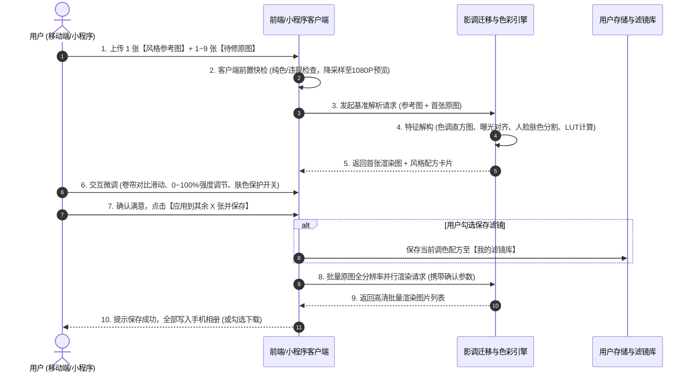
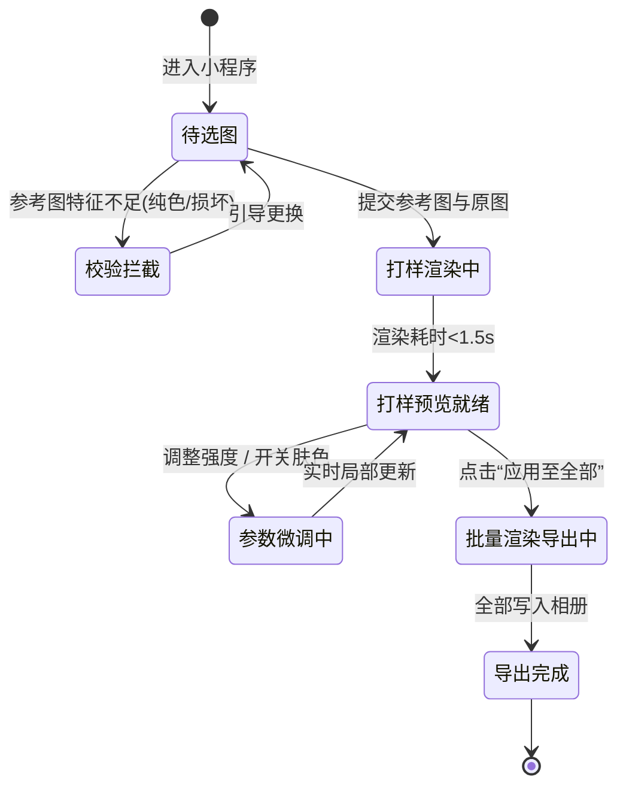

# 【产品需求文档】ToneRelay - 智能影调迁移与批量修图伴侣 (PRD)

| 文档版本 | 文档状态 | 编写人 | 创建日期 | 评审日期 |
| :--- | :--- | :--- | :--- | :--- |
| V1.0.0 (MVP) | Approved (共识达成) | 产品经理 (Superpower PRD 体系) | 2026-10-20 | 待排期 |

---

## 1. 需求背景与业务价值

### 1.1 业务背景与问题痛点
- **现状背景**：在小红书、Instagram、微博等社交平台上，高质量的视觉内容依赖于独特的色彩调性（如复古胶片感、富士日系、黑金冷调、低饱和法式等）。
- **核心痛点**：
  1. **专业调色门槛极高**：普通用户或摄影爱好者看到喜欢的风格图片，想要手动复刻时，面对专业修图软件（Lightroom、Photoshop、泼辣修图）的三色曲线、HSL 分离、色调分离、颗粒噪点等复杂参数无从下手。
  2. **传统通用滤镜千篇一律**：市面上现有修图 App 的固化滤镜无法根据原图的光比自适应，生搬硬套往往导致照片过曝、死黑或偏色。
  3. **人像发青发灰（肤色灾难）**：当参考图为冷绿或赛博朋克风格时，直接全局套色会导致人物脸色苍白、发绿发黑。
  4. **批量产出效率低下**：出游、聚会拍了九宫格照片，用户需要逐张微调，耗时繁琐。

### 1.2 业务目标与价值衡量 (Success Metrics)
- **核心目标**：实现“一张参考图解构影调逻辑 ➡️ 实时可视化微调 ➡️ 批量无损应用到待修照片”的极致轻量体验。
- **衡量指标 (KPI)**：
  - **单张成图与调色解析耗时**：预览成图时间 < 1.5 秒。
  - **批量九宫格导出转化率**：完成首张打样后，触发“批量导出”的用户转化率 ≥ 70%。
  - **调色满意度（强度保留率）**：用户在 0%~100% 强度滑块微调后，最终保存采纳率 ≥ 85%。
  - **专属滤镜留存复用率**：用户将生成的配方保存为“我的滤镜”并在未来 7 天内二次调用的比例 ≥ 35%。

---

## 2. 用户角色与画像

| 角色名称 | 典型场景 | 使用频次 | 核心诉求 | 关键权限 |
| :--- | :--- | :--- | :--- | :--- |
| **日常分享者 (主流)** | 朋友圈、小红书发图、旅行/聚会打卡 | 每周 2~4 次 (出游高频) | 极简操作、不想学调色、人脸肤色不能崩、能一次搞定九宫格 | 上传、调节强度、一键批量保存、收藏滤镜 |
| **轻度自媒体/博主** | 追求统一的社媒个人主页色调 (Feed Aesthetic) | 每日 | 能够解析爆款参考图的色调逻辑、固化成自己的专属滤镜库复用 | 配方查看、滤镜命名与管理、高清原图导出 |
| **系统管理员** | 平台运营与运维保障 | 低频 | 监控算法性能、拦截违规内容图片、配置推荐公共滤镜池 | 系统监控、日志审查、公共模版配置 |

---

## 3. 需求范围与边界界定

### 3.1 包含范围 (In-Scope / MVP)
- [x] **色彩与影调全局迁移**：色温/色调、高光阴影、对比度、三色曲线/LUT映射、胶片颗粒度、暗角。
- [x] **可视化修图配方与标签**：提炼并呈现可解释的风格标签（如“暖阳高光”、“青绿暗调”、“中度胶片质感”）及主色调色盘。
- [x] **交互式打样与微调**：单张卷帘对比（Before/After 左右滑动对比）、0%~100% 强度自由调节滑块。
- [x] **智能人脸肤色保护 (Skin Tone Guard)**：默认开启，自动分割/保护人物肤色色相，避免偏绿发灰。
- [x] **专属滤镜收藏与复用**：一键将提取的调色配方保存到“我的滤镜库”，下次可直接调用。
- [x] **多图批量修图 (Batch Processing)**：支持 1 张参考图 + 1~9 张原图，打样确认后一键并行渲染打包导出。
- [x] **性能与体验双轨策略**：预览阶段 1080P 秒级实时渲染，导出阶段无损原图分辨率渲染。
- [x] **容错与鲁棒性门控**：参考图色彩特征不足（全黑/纯白截图）前端快检拦截；跨曝光大光比自动直方图预对齐。

### 3.2 不包含范围 (Out-of-Scope / Non-Goals)
> 严格锁定边界，杜绝范围蔓延：
- ❌ **不支持生成式大模型重绘**：不使用 ControlNet / Stable Diffusion 进行场景重绘或添加不存在的物体（如添加云彩、落日），保证照片真实性。
- ❌ **不支持复杂形变与五官重塑**：本次不做瘦脸、大眼、增高等人像液化功能（建议用户在相机自带美颜中完成）。
- ❌ **不支持多图层复杂选区抠图**：除人像肤色智能保护外，不做复杂的笔刷局部蒙版。
- ❌ **暂不开放桌面端 Lightroom .xmp / 3D LUT 文件导出**（延后至 V2.0 专业版考虑）。

---

## 4. 业务架构与全局流程

### 4.1 核心业务主流程 (打样确认 ➡️ 批量应用动线)

### 4.2 核心业务状态机流转 (State Diagram)

---

## 5. 功能需求详细说明 (Feature Breakdown)

### 模块一：图像输入与前置门禁

#### 功能点 F-01：双槽选图与前置校验（优先级：P0）
1. **功能概述**：提供直观的两个选图插槽——槽位 A【灵感参考图】（单张）与槽位 B【待修原图】（支持 1~9 张多选）。
2. **前置条件**：已授予手机相册读取权限。
3. **界面交互**：
   - 槽位 A：支持从相册选择、拍照，或从“系统推荐风格库/我的历史滤镜”中快速挑选。
   - 槽位 B：支持九宫格宫格选图，右上角角标标明 `1/9` 序号，首张标记为【基准打样图】（支持用户长按拖拽调整顺序）。
4. **业务处理逻辑**：
   - **格式支持**：JPG, PNG, HEIC, WebP。
   - **客户端降采样预加载**：大图进入界面时，客户端生成 1080P 缩略图用于即时上传，原图二进制句柄保留在本地内存待最终导出调用。
5. **异常与分支处理 (Edge Cases)**：
   - **参考图色彩特征不足校验**：计算参考图的色彩熵与明度方差。若方差 < 阈值（如全白、全黑、纯色截图），拦截并 Toast 提示：*“这张参考图色彩太单一啦，换一张光影更丰富的照片试试吧~”*。

---

### 模块二：影调解构与打样微调

#### 功能点 F-02：自动曝光预对齐与影调迁移（优先级：P0）
1. **功能概述**：系统分析参考图的影调曲线（Tone Curve）、全局色调色温、色相分布（Hue Matrix）及颗粒质感，并自适应匹配至原图。
2. **业务处理逻辑**：
   - **自动曝光预对齐**：当原图与参考图平均明度差异超过 40% 时（如夜景参考图搭配正午日光原图），算法自动执行高光/暗部对齐压制，防止画面死黑或全白过曝。
   - **质感层叠加**：按参考图噪点比重，自适应叠加胶片细颗粒感与轻微边缘暗角（Vignette）。

#### 功能点 F-03：智能人像肤色保护 (Skin Tone Guard)（优先级：P0）
1. **功能概述**：防止艺术色调破坏人脸自然质感。
2. **业务处理逻辑**：
   - 检测原图中是否存在人脸/皮肤区域（HSV 色相区间 `[0, 50]` 结合人脸轮廓检测）。
   - **保护开关（默认开启）**：开启状态下，人脸区域色彩仅继承参考图的明暗光影对比，限制肤色色相产生强烈偏移，保持红润通透；关闭状态下，进行全局无差别色彩映射。

#### 功能点 F-04：单张卷帘对比与配方卡片（优先级：P0）
1. **功能概述**：首张打样图在屏幕中央呈现，提供直观对比与微调能力。
2. **界面交互**：
   - **卷帘滑动条 (Split Slider)**：左右拖动即可对比【修图前 (Original)】与【调色后 (Styled)】。
   - **风格配方卡片**：在图片下方以标签胶囊展示（例如：`🏷️ 暖阳高光 +18`、`🏷️ 青冷暗部 -12`、`🏷️ 胶片颗粒 弱`）。
   - **强度调节滑块**：提供 `0% ~ 100%` 无级强度滑块（默认 100%），拖动时实时线性插值当前调色矩阵。
   - **肤色保护勾选框**：提供【保留自然肤色】快捷切换 Toggle。

---

### 模块三：批量处理与资产沉淀

#### 功能点 F-05：多图批量并行渲染与导出（优先级：P0）
1. **功能概述**：用户确认首张打样效果后，将当前确认的参数矩阵一键应用至所有选定的原图并保存。
2. **业务处理逻辑**：
   - 用户点击【应用到其余 X 张并保存】按钮。
   - 客户端采用**双轨导出**机制：读取本地无损原始分辨率图片，调用色彩变换核心，逐张生成高清无损照片。
   - 界面展示批量处理进度条（如 `正在处理 3/9...`）。
   - 渲染完成后自动写入系统系统相册，并弹出完成弹窗。
3. **异常处理**：若某张单图由于内存不足渲染失败，记录失败并在最后提供“第 X 张失败，点击重试”按钮，不阻断其余成功图片的保存。

#### 功能点 F-06：一键存为“我的专属滤镜”（优先级：P1）
1. **功能概述**：将当前满意的修图参数抽象为滤镜资产沉淀。
2. **界面交互**：
   - 导出页面提供【⭐ 存为专属滤镜】操作项。
   - 弹窗支持自定义输入滤镜名称（默认按当前场景生成名字，如“日落橘调_20261020”）。
   - 存储于客户端本地（LocalStorage / IndexedDB）及云端账号（若已登录）。在首页槽位 A 可随时一键切换选用。

---

## 6. 非功能性需求 (NFR)

1. **响应与性能 (Latency & Performance)**：
   - **打样预览首绘**：上传双图后，打样预览图片呈现时间 ≤ 1.5 秒。
   - **强度滑块拖动延迟**：帧率保持 ≥ 30 FPS，无明显卡顿掉帧。
   - **单张高清原图导出渲染**：4000万像素照片导出时间 ≤ 2.5 秒/张。
2. **兼容性与端能力**：
   - 移动端适配 iOS 14+ Safari、微信小游戏/小程序基础库 2.20+、Android 主流机型。
   - 支持主流屏幕纵横比（16:9, 4:3, 1:1, 9:16）。
3. **安全性与隐私**：
   - **纯本地/边缘处理优先**：调色矩阵与像素处理优先在客户端 Canvas / WebGL / WebAssembly (Wasm) 执行，原图无需上传远程服务器，最大限度保护用户相册隐私。

---

## 7. 数据埋点与运营监控

| 埋点事件名称 | 事件标识 (Event ID) | 触发时机 | 携带参数 | 分析目的 |
| :--- | :--- | :--- | :--- | :--- |
| 参考图上传 | `ref_image_uploaded` | 用户完成槽位 A 选图 | `image_size, has_skin` | 监控用户偏好的参考图来源 |
| 打样结果生成 | `preview_render_success` | 首张对比图渲染完毕 | `cost_ms, is_fallback` | 性能与算法耗时监控 |
| 强度滑块调节 | `intensity_slider_change` | 用户松开滑块控件 | `final_intensity` | 评估默认效果与微调偏差 |
| 批量导出点击 | `batch_export_click` | 点击应用至全部 | `image_count` | 衡量批量需求占比 |
| 专属滤镜保存 | `save_filter_click` | 点击保存滤镜按钮 | `filter_name` | 衡量功能黏性与资产沉淀率 |

---

## 8. 实施计划与里程碑 (Roadmap)

| 阶段 | 周期 | 核心交付物 | 责任人 |
| :--- | :--- | :--- | :--- |
| **Phase 1: 原型与视觉定稿** | Day 1~2 | 完成移动端核心三屏高保真交互原型 (双槽选图页、卷帘打样页、批量导出页) | UI / PM |
| **Phase 2: 核心算法与 Wasm 原型** | Day 3~5 | 实现色彩直方图解构、LUT 生成、人脸肤色保护与 WebGL/Wasm 渲染引擎验证 | 核心算法研发 |
| **Phase 3: 客户端联调与批量工程** | Day 6~8 | 完成移动端 UI 串联、九宫格批量流水线、相册读写与滤镜本地存储 | 前端/移动研发 |
| **Phase 4: 性能调优与容错回归** | Day 9~10 | 边缘案例测试（全黑/过曝/极端宽高比）、全机型内存占用与真机验证 | QA / 全员 |
| **Phase 5: MVP 灰度上线** | Day 11 | 发布 V1.0.0 小程序/H5 体验版 | PM / 运维 |

---

## 9. 风险识别与备选方案

| 潜在风险项 | 影响级别 | 应对与缓解策略 |
| :--- | :--- | :--- |
| 移动端九宫格批量高清导出导致浏览器内存溢出 (OOM) | **高** | 严禁多张原图同时在内存中解压，采用**串行队列 (Serial Pipeline)** 渲染：处理完一张写入相册并立即垃圾回收 (GC)，再处理下一张。 |
| 用户上传的低分辨率极小截图导致色块断层 | **中** | 在解析色彩梯度时引入高斯模糊低通滤波（Gaussian Blur Filter），平滑色彩分布，避免出现色带阶梯。 |
