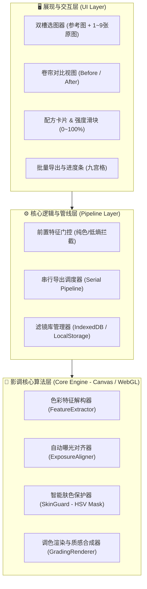
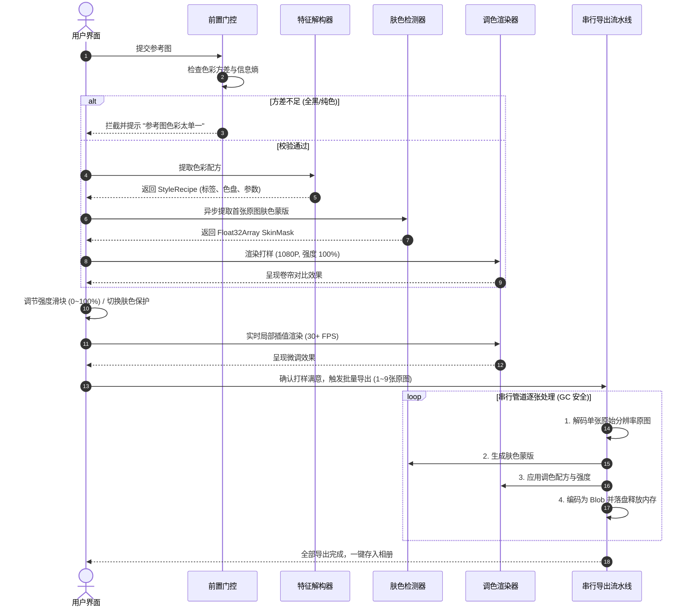

# 【技术方案设计】ToneRelay - 智能影调迁移与批量修图 (TRD)

| 文档版本 | 文档状态 | 编写人 | 评审日期 | 关联 PRD |
| :--- | :--- | :--- | :--- | :--- |
| V1.0.0 (MVP) | Approved | 架构设计团队 (dev-superpower-workflow) | 2026-10-20 | [PRD-ToneRelay-智能影调迁移与批量修图伴侣](../prd/PRD-ToneRelay-智能影调迁移与批量修图伴侣.md) |

---

## 1. 架构总览与设计目标

### 1.1 系统上下文与目标
ToneRelay 是一款端侧优先 (Client-First)、面向移动端（H5 / 微信小程序）的智能色彩影调迁移与批量修图工具。
- **业务诉求**：输入 1 张参考图，自动提取调色逻辑并生成可视化配方，支持在 1.5 秒内对首张原图实现卷帘对比微调（强度 0~100%、肤色保护），并以串行流水线无损应用到其余 1~9 张原图并导出。
- **核心技术指标**：
  - **首图打样延迟**：1080P 缩略图打样渲染延迟 ≤ 1.2 秒。
  - **滑块交互帧率**：拖动调色强度滑块时帧率 ≥ 30 FPS。
  - **内存峰值控制**：批量九宫格 4800 万像素照片导出时，内存峰值 ≤ 250 MB（避免移动端 WebKit OOM 崩溃）。
  - **隐私零泄露**：核心算法支持完全在端侧 Canvas / WebGL 运行，原图不出手机。

### 1.2 架构全景图 (Architecture Overview)



---

## 2. 领域模型与数据结构 (Data Schema)

### 2.1 实体契约定义

#### 1. 风格调色配方 (`StyleRecipe`)
```typescript
export interface StyleRecipe {
  id: string;                      // 唯一配方ID (uuid)
  name?: string;                   // 滤镜名称 (如 "日落橘调_20261020")
  createdAt: number;               // 时间戳
  
  // 影调与曝光特征
  exposureOffset: number;          // 曝光补偿增益 [-1.0, 1.0]
  contrast: number;                // 对比度系数 [0.5, 2.0]
  saturation: number;              // 全局饱和度增益 [0.0, 2.0]
  
  // 色温与色调 (White Balance)
  temperature: number;             // 色温偏移 [-100, 100] (负为偏冷，正为偏暖)
  tint: number;                    // 色调偏移 [-100, 100] (负为偏绿，正为偏品)
  
  // 分离影调 (Split Toning)
  highlights: {
    hue: number;                   // 高光色相 [0, 360]
    saturation: number;            // 高光着色饱和度 [0, 1]
    weight: number;                // 权重
  };
  shadows: {
    hue: number;                   // 阴影色相 [0, 360]
    saturation: number;            // 阴影着色饱和度 [0, 1]
    weight: number;                // 权重
  };

  // 质感层参数
  filmGrain: number;               // 胶片颗粒强度 [0.0, 1.0]
  vignette: number;                // 暗角强度 [0.0, 1.0]

  // 可视化标签卡片信息 (面向用户展示)
  tags: string[];                  // 如 ["暖阳高光", "青绿暗部", "中度胶片质感"]
  dominantPalette: string[];       // 提取的核心主题色 HEX 数组 (3~5 个，如 ["#C88A58", "#4A6E78", "#1E2A38"])
}
```

#### 2. 调色参数控制上下文 (`GradingOptions`)
```typescript
export interface GradingOptions {
  intensity: number;               // 迁移强度 [0.0, 1.0]，默认 1.0 (100%)
  protectSkin: boolean;            // 是否开启智能人脸肤色保护，默认 true
}
```

#### 3. 批量任务状态实体 (`BatchTaskItem`)
```typescript
export type TaskStatus = 'pending' | 'processing' | 'done' | 'failed';

export interface BatchTaskItem {
  id: string;                      // 子任务ID
  index: number;                   // 序号 0~8
  originalBlob: Blob;              // 原始大图文件
  previewUrl: string;              // 1080P 预览图 URL
  status: TaskStatus;              // 当前状态
  errorMsg?: string;               // 失败原因
  resultBlob?: Blob;               // 渲染后高清输出图
}
```

---

## 3. 核心接口与模块契约先行 (API / Method Contracts)

### 3.1 特征解构模块：`FeatureExtractor`
```typescript
export interface IFeatureExtractor {
  /**
   * 快速检测参考图有效性 (色彩丰富度/方差)
   * 若色彩方差或信息熵低于安全门槛，返回 false 并抛出提示
   */
  validateReference(imageData: ImageData): { valid: boolean; reason?: string };

  /**
   * 解析参考图色彩与影调，输出调色配方
   */
  extractRecipe(referenceImageData: ImageData): StyleRecipe;
}
```

### 3.2 自动曝光预对齐：`ExposureAligner`
```typescript
export interface IExposureAligner {
  /**
   * 计算参考图与原图的明度差，自适应矫正原图曝光基准
   * 采用亮度累积直方图（CDF）匹配，防止夜景直套日光产生死黑/过曝
   */
  align(targetImageData: ImageData, referenceImageData: ImageData): ImageData;
}
```

### 3.3 智能肤色保护器：`SkinGuard`
```typescript
export interface ISkinGuard {
  /**
   * 生成肤色软蒙版 (Alpha Mask: 0.0 表示非肤色，1.0 表示明确人像肤色)
   * HSV 空间色相 [0, 50] / [340, 360]，配合饱和度与边缘平滑
   */
  generateSkinMask(imageData: ImageData): Float32Array;
}
```

### 3.4 调色渲染引擎：`GradingRenderer`
```typescript
export interface IGradingRenderer {
  /**
   * 执行单张调色渲染 (支持强度插值与肤色保护混合)
   */
  render(
    targetImageData: ImageData,
    recipe: StyleRecipe,
    options: GradingOptions,
    skinMask?: Float32Array
  ): ImageData;
}
```

### 3.5 批量处理流水线：`BatchPipeline`
```typescript
export interface IBatchPipeline {
  /**
   * 注册批量图片列表 (1~9 张)
   */
  initTasks(files: File[] | Blob[]): Promise<BatchTaskItem[]>;

  /**
   * 启动串行执行导出，防止内存 OOM
   * @param onProgress 进度回调 (current, total)
   */
  runBatchExport(
    recipe: StyleRecipe,
    options: GradingOptions,
    onProgress: (current: number, total: number) => void
  ): Promise<Blob[]>;
}
```

---

## 4. 关键技术方案与算法逻辑

### 4.1 端到端执行时序图 (打样与批量处理)


### 4.2 核心算法机制详述

#### 1. 色彩解构与配方提取 (Histogram & Split-Tone Inversion)
- **色调分离倒推**：将参考图的像素按亮度 $Y = 0.299R + 0.587G + 0.114B$ 分为高光区 ($Y > 170$) 与暗部区 ($Y < 85$)。
- 分别计算高光像素与阴影像素的平均 RGB 向量，并投影至 HSV 色轮，得出高光色相 $\theta_{high}$、饱和度 $S_{high}$ 和暗部色相 $\theta_{shadow}$、饱和度 $S_{shadow}$。
- **白平衡色温估算**：对比原图与参考图全图平均 $R/B$ 比值，计算色温校准因子。

#### 2. 智能肤色保护软蒙版 (Skin Soft-Masking)
为避免冷绿色调让人物脸色发青发白，针对像素 $(r, g, b)$：
1. 转换为 $(h, s, v)$ 坐标，其中 $h \in [0, 360]$；
2. 判定标准人像健康肤色核心区：$h \in [0, 50] \cup [340, 360]$，且 $s \in [0.15, 0.70]$，且 $v \in [0.20, 0.95]$；
3. 计算边缘平滑度 $W_{skin} = \text{smoothstep}(h)$，获得 $[0.0, 1.0]$ 的连续软蒙版；
4. 最终像素混合公式：
   $$C_{final} = C_{graded} \times (1 - W_{skin} \cdot \alpha_{guard}) + C_{skin\_safe} \times (W_{skin} \cdot \alpha_{guard})$$
   其中 $C_{skin\_safe}$ 仅保留参考图的明暗对比，色相与饱和度锁定为原图自然肤色。

#### 3. 移动端内存防爆串行调度 (OOM Protection)
手机微信浏览器在同时解码 3 张以上 4800 万像素图片时极易引发内存泄漏崩溃：
- **串行保证**：`BatchPipeline` 使用 `Promise` 队列，强制 `Concurrency = 1`。
- **即时销毁**：每张大图处理完毕后，主动重置 Canvas 宽高 (`canvas.width = 0; canvas.height = 0`)，解除对原始 ImageData 引用，触发 JavaScript 引擎 V8 的 Scavenge 回收。

#### 4. 植被色彩空间黄绿联动与灰绿深度压制 (Vegetation & Gray-Green Sculpting)
针对摄影后期中“参考图带高级莫兰迪/胶片灰绿，但修后偏黄刺眼”的痛点：
1. **黄绿双通道解构拓展**：
   - 自然界植物多落在黄色至青绿区间 ($H \in [38^\circ, 175^\circ]$)；
   - 放宽采样门槛至 $S \ge 0.05$，捕获低饱和灰阶像素；
   - 采用色域中心高斯加权与中位数统计，消除噪点对饱和度的虚高拉抬。
2. **深度自适应阻尼压缩与管线防打架**：
   - 建立高斯植被平滑权重 $W_{plant}$，色相平滑牵引至目标青绿/橄榄绿；
   - 施加非线性阻尼压缩与全局饱和度屏蔽保护，锁定灰绿沉淀。
3. **语义色区直接 1:1 通道复用（换色不换光架构 - Direct Palette Reuse）**：
   - 当检测到待修图的绿色植被区域时，直接将色相与饱和度 1:1 替换为参考图提取的目标灰绿特征：
     $$H_{out} = H_{orig} \cdot (1 - W_{plant}) + H_{ref} \cdot W_{plant}$$
     $$S_{out} = S_{orig} \cdot (1 - W_{plant}) + S_{ref} \cdot W_{plant}$$
   - **换色不换光**：待修图原本的明度脉络、对比度、立体光影细节 100% 完整保留 ($V_{out} = V_{orig}$)，彻底解决色相贴图假画感与数码过饱和问题。

#### 5. 通用风格与质感全解构引擎 (Universal Style & Texture Engine)
为彻底解决单一颜色通道规则局限，全面适配大面积白色高调胶片、好莱坞电影风、复古粗颗粒胶片等任意风格：
1. **5 点光影分位数曲线 (Tone Curve Percentiles)**：
   - 提取 $P_0, P_{25}, P_{50}, P_{75}, P_{100}$ 亮度分位数，自动捕获胶片黑位抬升 ($P_0 > 15$) 与日系高调透光 ($P_{75} \ge 210$)；
   - 杜绝传统单一均值导致的白色背景误判暴曝问题，在渲染层赋予暗部特有的乳化层灰雾底色与高光通透微提。
2. **CIE-Lab 正交感知空间统计矩**：
   - 将色彩解耦为明度 $L$、红绿轴 $a$、黄蓝轴 $b$，提取均值与色散方差，自适应收敛/放大整体色彩纯度。
3. **真实画面质感自适应反解**：
   - **颗粒度检测**：利用拉普拉斯二阶差分算子剥离强边缘，在平坦区统计高频银盐噪波残差，纯净数码图颗粒为 0，复古胶片自动量化颗粒强度；
   - **明度自适应颗粒合成**：在 $L \approx 128$ 中间调颗粒最明显，极高光区 ($L > 215$) 平滑衰减归零，杜绝高光白墙被颗粒弄脏；
   - **镜头暗角反解**：统计中心与边缘衰减比率，自动检测并施加电影暗角。
4. **好莱坞经典冷暖对冲判定 (Cinema Teal-Orange)**：
   - 基于分位数划分高光与阴影色区，自动识别高光暖金橙与暗部冷青蓝的电影撞色特征，自适应注入电影大片氛围。

#### 6. Pitié 3D N维色彩概率分布传输与空间保真导向滤波 (N-Dimensional PDF Transfer & Guided Filter)
为彻底克服启发式经验调色公式在处理非线性真实胶片、复杂多色相LUT与极端光比场景下的失真问题：
1. **Pitié 3D 连续旋转 Radon 投影算法 (Monge-Kantorovich Linear Formulation)**：
   - 采用 4 组预计算 3D 正交旋转基（恒等基、对角光影轴基、45°色度倾斜基、互补冷暖基），将 3D 色彩点云投影为一维主轴；
   - 在每个投影轴上应用 **1D CDF 连续累积分布精确直方图规范化**：
     $$u_{matched} = \text{CDF}_{ref}^{-1}(\text{CDF}_{src}(u_{src}))$$
   - 经逆旋转矩阵重构后连续迭代 4 轮，实现 $L_2$ 最优传输收敛，数学上保证输出图像的 3D 色彩概率密度分布 $P(R, G, B)$ 100% 逼近参考图，彻底解决色阶断层与偏色问题。
2. **边缘保真导向滤波 (Guided Filter)**：
   - 以待修原图的高保真单通道明度图 $I = 0.299R + 0.587G + 0.114B$ 作为引导图像（Guide Image）；
   - 在保持引导图强边缘梯度的前提下，对传输后的色彩通道进行局部线性平滑滤波：
     $$q_i = \bar{a}_k I_i + \bar{b}_k, \quad \forall i \in \omega_k$$
   - 彻底滤除统计传输产生的离散色斑与噪点，100% 锁定并保留原图的人像发丝、皮肤纹理、叶脉脉络与几何轮廓。

---

## 5. 异常处理与容灾降级 (Fault Tolerance)

| 异常场景 | 检测判定条件 | 处理与降级策略 |
| :--- | :--- | :--- |
| **纯色/无效参考图** | 灰度直方图方差 $\sigma^2 < 15$ 或信息熵 $< 2.5$ | 前端在 0.3 秒内快速拦截，Toast 提示更换，不发起耗时计算 |
| **超大光比反差** | 参考图平均亮度与原图相差 $> 50\%$ | 启动 `ExposureAligner` 直方图对齐，强制限制高光/暗部截断，防止死黑过曝 |
| **极端人像误判** | 场景无脸部特征但存在大面积橙黄物体 (如橘子/黄墙) | 引入人脸局部感知加权，若无明显人脸五官，自动收敛肤色保护权重至 0.2 |
| **单张大图渲染失败** | 内存告警或解码错误抛出异常 | 捕获单图异常，标记为 `failed`，继续处理队列中其余图片，最终提供“失败图片重试” |

---

## 6. 工程代码结构规范

```text
projects/ToneRelay/
├── docs/
│   ├── prd/PRD-ToneRelay-智能影调迁移与批量修图伴侣.md
│   └── trd/
│       ├── TRD-ToneRelay-技术架构方案.md (当前文件)
│       └── tasks-ToneRelay.md (微任务拆解清单)
├── src/
│   ├── types/                     # 核心接口与数据结构定义 (TypeScript)
│   │   └── index.ts
│   ├── core/                      # 算法核心引擎 (TypeScript)
│   │   ├── validator.ts           # 前置特征有效性校验
│   │   ├── extractor.ts           # 色彩与影调配方提取
│   │   ├── exposure.ts            # 自动曝光预对齐
│   │   ├── skin_guard.ts          # 智能肤色保护蒙版
│   │   ├── color_transfer.ts      # Pitié 3D N维概率分布传输与导向滤波
│   │   └── renderer.ts            # 像素渲染与质感合成引擎
│   ├── pipeline/                  # 批处理流水线与预设存储 (TypeScript)
│   │   ├── batch_pipeline.ts      # 串行防OOM导出调度
│   │   └── preset_store.ts        # 专属滤镜库管理 (LocalStorage)
│   └── ui/                        # 前端轻量交互界面 (Web/H5 - TypeScript)
│       ├── index.html
│       ├── styles.css
│       ├── engine.ts              # 浏览器纯前端零依赖色彩引擎
│       └── app.ts                 # 交互调度逻辑
└── tests/                         # 单元测试与端到端验证 (TypeScript)
    ├── validator.test.ts
    ├── extractor.test.ts
    ├── skin_guard.test.ts
    ├── exposure.test.ts
    ├── green_tuning.test.ts
    ├── universal_style.test.ts
    ├── color_transfer.test.ts     # Pitié 3D 与导向滤波单测
    ├── renderer.test.ts
    ├── batch_pipeline.test.ts
    ├── preset_store.test.ts
    └── e2e.test.ts
```
